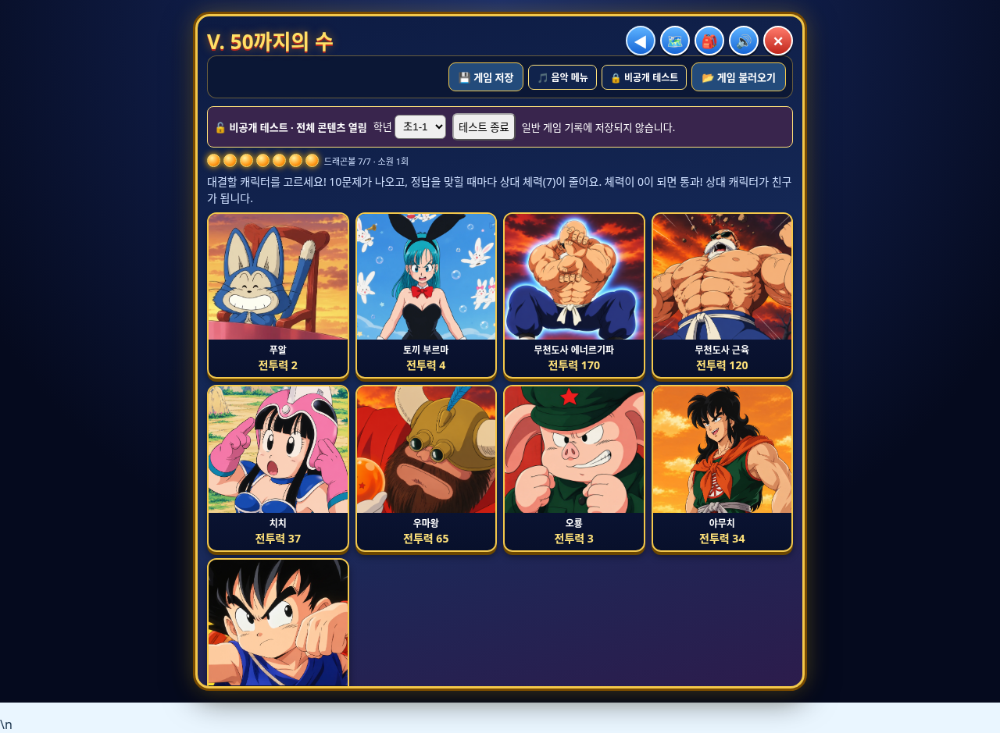

# 원기랜드 수정본 v6 다운로드

**파일 이름: `wonkiland_fixed_v6.html`**

초1-1 5단원을 요청한 9명 이미지로 구성하고 무천도사 근육·에너르기파를 새로 업로드한 원본 PNG로 교체했습니다. 순서는 푸알 → 토끼 부르마 → 무천도사 에너르기파 → 무천도사 근육 → 치치 → 우마왕 → 오룡 → 야무치 → 손오공입니다.

## 다운로드

각 파일을 열고 **Download raw file** 버튼으로 세 파일 모두 같은 폴더에 저장하세요. 각 파일은 25MB 이하입니다.

- [첫 번째 파일 (24MB)](wonkiland_fixed_v6.zip.001)
- [두 번째 파일 (24MB)](wonkiland_fixed_v6.zip.002)
- [세 번째 파일 (약 14.5MB)](wonkiland_fixed_v6.zip.003)

Windows에서 저장 폴더 주소창에 `cmd`를 입력해 실행한 뒤:

```bat
copy /b wonkiland_fixed_v6.zip.001+wonkiland_fixed_v6.zip.002+wonkiland_fixed_v6.zip.003 wonkiland_fixed_v6.zip
```

macOS/Linux:

```sh
cat wonkiland_fixed_v6.zip.001 wonkiland_fixed_v6.zip.002 wonkiland_fixed_v6.zip.003 > wonkiland_fixed_v6.zip
```

ZIP을 풀고 **wonkiland_fixed_v6.html**을 Neocities에 업로드한 뒤 새 v6 주소로 접속하세요. 게임 저장 옆 비공개 테스트(비밀번호 **5283**)에서 초1-1의 5단원을 확인할 수 있습니다.

기존 4단원과 저화질 우마왕 선택란 제거를 유지했습니다. 일반 게임의 기존 플레이어·친구 제외 규칙도 유지했습니다.

## 검증

PC·모바일에서 9명 이미지 로드와 각 대결 진입, 업로드한 PNG 원본 일치, 일반 저장 기록 불변, 32개 스크립트 구문 검사를 확인했습니다. 신규 실행 오류는 없었습니다. 원본 회원 수강과목 cloneNode 오류는 그대로입니다. 실제 Neocities 배포는 작업 환경에서 검증하지 못했습니다.

[상세 변경 내역](변경내역.md)


