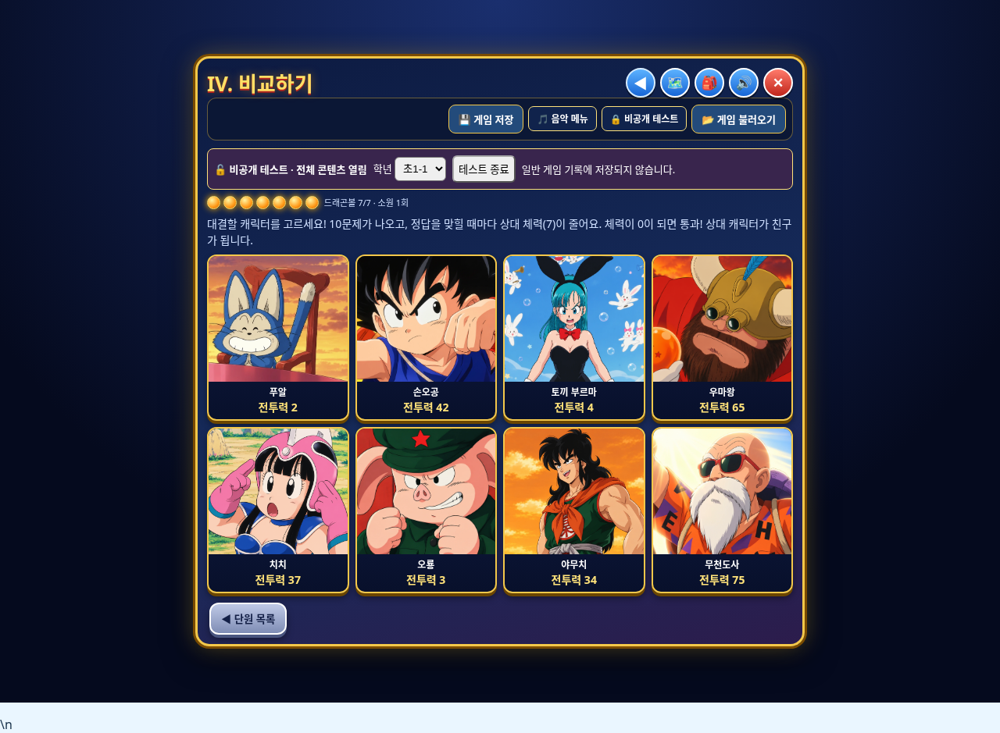

# 원기랜드 수정본 v5 다운로드

**파일 이름: `wonkiland_fixed_v5.html`**

초1-1의 **4단원 비교하기**에 푸알·손오공·토끼 부르마·우마왕·치치·오룡·야무치·무천도사, 총 8명을 구성했습니다. 우마왕과 치치는 새로 제공한 PNG를 원본 그대로 연결했습니다.

저화질 우마왕은 일반·비공개 캐릭터 선택란에서 제거하고 고화질 우마왕만 유지했습니다. 기존 저장기록도 유지합니다.

## 다운로드

각 파일을 열고 **Download raw file** 버튼으로 세 파일 모두 같은 폴더에 저장하세요.

- [첫 번째 파일 (20MB)](wonkiland_fixed_v5.zip.001)
- [두 번째 파일 (20MB)](wonkiland_fixed_v5.zip.002)
- [세 번째 파일 (약 19MB)](wonkiland_fixed_v5.zip.003)

Windows에서 해당 폴더의 주소창에 `cmd`를 입력해 실행한 뒤:

```bat
copy /b wonkiland_fixed_v5.zip.001+wonkiland_fixed_v5.zip.002+wonkiland_fixed_v5.zip.003 wonkiland_fixed_v5.zip
```

macOS/Linux:

```sh
cat wonkiland_fixed_v5.zip.001 wonkiland_fixed_v5.zip.002 wonkiland_fixed_v5.zip.003 > wonkiland_fixed_v5.zip
```

ZIP을 압축 해제하고 **wonkiland_fixed_v5.html**을 Neocities에 업로드한 뒤 새 v5 주소를 여세요.

게임 저장 옆의 비공개 테스트에서 **5283**을 입력하고 초1-1 → 4단원으로 들어가면 8명 모두 확인할 수 있습니다. 일반 게임의 기존 플레이어/친구 제외 규칙은 유지했습니다.

## 검증

PC·모바일에서 8명 모두 이미지 로드와 대결 진입, 업로드한 두 PNG의 원본 일치, 32개 스크립트 구문 검사를 통과했습니다. 새 JavaScript 실행 오류는 없었습니다. 나머지 v3 코드·데이터는 그대로이며 원본 회원 수강과목 cloneNode 오류도 보존했습니다. 실제 Neocities 배포 확인은 작업 환경의 접근 제한으로 수행하지 못했습니다.

[상세 변경 내역](변경내역.md)


