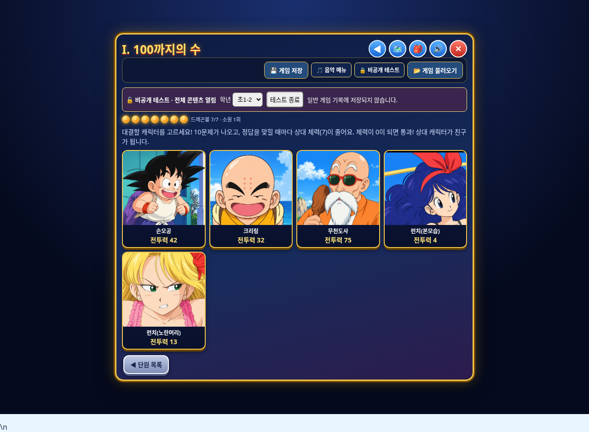

# 원기랜드 수정본 v7 다운로드

**파일 이름: `wonkiland_fixed_v7.html`**

초1-2의 이미지 23개 항목을 보내주신 원본 21장으로 교체했습니다. 이미지 이외의 이름·전투력·규칙·단원 구성은 그대로입니다. 초1-1의 기존 수정도 유지됩니다.

## 다운로드 — 이번에는 4개 파일입니다

각 파일을 열고 **Download raw file** 버튼으로 네 파일 모두 같은 폴더에 저장하세요. 각 파일은 25MB 이하입니다.

- [첫 번째 파일 (24MB)](wonkiland_fixed_v7.zip.001)
- [두 번째 파일 (24MB)](wonkiland_fixed_v7.zip.002)
- [세 번째 파일 (24MB)](wonkiland_fixed_v7.zip.003)
- [네 번째 파일 (약 16MB)](wonkiland_fixed_v7.zip.004)

Windows에서 저장 폴더 주소창에 `cmd`를 입력해 실행한 뒤:

```bat
copy /b wonkiland_fixed_v7.zip.001+wonkiland_fixed_v7.zip.002+wonkiland_fixed_v7.zip.003+wonkiland_fixed_v7.zip.004 wonkiland_fixed_v7.zip
```

macOS/Linux:

```sh
cat wonkiland_fixed_v7.zip.001 wonkiland_fixed_v7.zip.002 wonkiland_fixed_v7.zip.003 wonkiland_fixed_v7.zip.004 > wonkiland_fixed_v7.zip
```

ZIP을 풀고 **wonkiland_fixed_v7.html**을 Neocities에 업로드한 뒤 새 v7 주소로 접속하세요. HTML에 이미지가 내장되어 있으며 파일 크기는 약 118MB입니다. 게임 저장 옆 비공개 테스트(비밀번호 **5283**)에서 초1-2를 선택해 확인할 수 있습니다.

## 검증

PC·모바일에서 23개 이미지 항목의 로드·원본 해시 일치, 6개 단원과 23종 상대의 대결 진입, 이름·전투력 및 일반 저장 기록 유지를 확인했습니다. 새 JavaScript 오류는 없었고 전체 32개 스크립트 구문 검사도 통과했습니다. 원본 회원 수강과목 cloneNode 오류는 유지됩니다. 실제 Neocities 배포 검증은 수행하지 않았습니다.

[이미지 연결 목록](초1-2-이미지연결.md) · [상세 변경 내역](변경내역.md)


