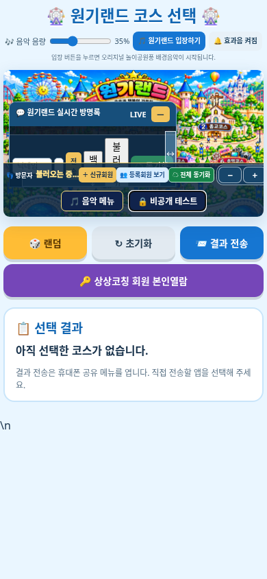

# 원기랜드 수정본 v2 다운로드

**이번 파일 이름은 `wonkiland_fixed_v2.html`입니다.** 이전 파일과 혼동하지 마세요.

음악 메뉴와 비공개 테스트 메뉴는 메인 지도 하단의 방문자·신규회원·전체 동기화 메뉴 영역 안으로 옮겼습니다. 오른쪽 아래 고정을 제거하고 비밀번호 창을 여는 코드를 교체했습니다. 비밀번호는 **5283**입니다.

## 다운로드

아래 세 파일을 각각 열고 **Download raw file(다운로드)** 버튼을 눌러 모두 같은 폴더에 저장하세요. 파일 이름은 변경하지 마세요.

- [첫 번째 파일 (20MB)](wonkiland_fixed_v2.zip.001)
- [두 번째 파일 (20MB)](wonkiland_fixed_v2.zip.002)
- [세 번째 파일 (약 15.8MB)](wonkiland_fixed_v2.zip.003)

Windows에서 해당 폴더를 열고 주소창에 `cmd`를 입력해 실행한 뒤 다음 명령을 입력하세요.

```bat
copy /b wonkiland_fixed_v2.zip.001+wonkiland_fixed_v2.zip.002+wonkiland_fixed_v2.zip.003 wonkiland_fixed_v2.zip
```

macOS/Linux에서는 해당 폴더에서 다음 명령을 실행하세요.

```sh
cat wonkiland_fixed_v2.zip.001 wonkiland_fixed_v2.zip.002 wonkiland_fixed_v2.zip.003 > wonkiland_fixed_v2.zip
```

생성된 ZIP을 압축 해제한 뒤 `wonkiland_fixed_v2.html`을 Neocities의 기존 파일과 같은 폴더에 새 파일명으로 업로드하세요. 기존 `wonkiland_fixed` 대신 새 `wonkiland_fixed_v2` 주소를 여세요. 기존 원본은 보관하세요.

## 검증 및 확인 범위

데스크톱 클릭·모바일 터치, 5283 입력, 게임 열기/닫기 3회 반복, 음악 조작, 메뉴 실제 좌표와 이벤트 중복 여부를 로컬 HTTP 및 Chromium에서 확인했습니다. 새 실행 오류는 없었습니다. 원본 회원 수강과목 코드의 cloneNode 오류는 변경 금지 요청에 따라 보존했습니다.

제공된 Neocities 페이지는 작업 환경에서 HTTP 403 응답을 받아 실제 배포본을 직접 확인하지 못했습니다. 아래는 로컬 검증한 v2의 모바일 화면입니다. [변경 내역과 검증 범위](변경내역.md)


