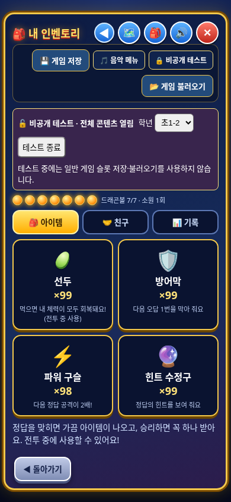

# 원기랜드 수정본 v3 다운로드

**이번 파일 이름은 `wonkiland_fixed_v3.html`입니다.**

게임 화면에서 **게임 저장 → 음악 메뉴 → 비공개 테스트 → 게임 불러오기** 순서로 표시합니다. 비공개 테스트 비밀번호는 **5283**입니다.

## 다운로드

아래 파일을 각각 열고 **Download raw file** 버튼으로 모두 같은 폴더에 저장하세요.

- [첫 번째 파일 (20MB)](wonkiland_fixed_v3.zip.001)
- [두 번째 파일 (20MB)](wonkiland_fixed_v3.zip.002)
- [세 번째 파일 (약 15.8MB)](wonkiland_fixed_v3.zip.003)

Windows에서 파일을 저장한 폴더 주소창에 `cmd`를 입력해 명령 프롬프트를 열고 실행하세요.

```bat
copy /b wonkiland_fixed_v3.zip.001+wonkiland_fixed_v3.zip.002+wonkiland_fixed_v3.zip.003 wonkiland_fixed_v3.zip
```

macOS/Linux:

```sh
cat wonkiland_fixed_v3.zip.001 wonkiland_fixed_v3.zip.002 wonkiland_fixed_v3.zip.003 > wonkiland_fixed_v3.zip
```

합친 ZIP을 압축 해제하고 **wonkiland_fixed_v3.html**을 Neocities에 업로드한 뒤 새 v3 주소로 접속하세요. 게임을 연 뒤 게임 저장 옆 메뉴를 확인하세요.

## 비공개 테스트

초1-1의 5개 단원·13개 캐릭터, 초1-2의 6개 단원·23개 캐릭터와 모든 자료가 있는 지도 지역을 확인할 수 있습니다. 아이템은 각 99개를 제공하며 일반 게임의 진행·잠금·슬롯에는 반영하지 않습니다. 테스트 종료/닫기 후 일반 상태로 돌아옵니다.

PC와 모바일 Chromium에서 모든 단원 진입, 음악 조작, 비밀번호, 일반 기록 보호·잠금 복원, 메뉴 좌표와 이벤트 중복을 검증했습니다. 새 JavaScript 오류는 없었습니다. 원본의 회원 수강과목 cloneNode 오류는 보존했습니다. 실제 Neocities 배포 확인은 환경의 403 응답으로 수행하지 못했습니다.

[상세 변경 내역과 검사 범위](변경내역.md)


