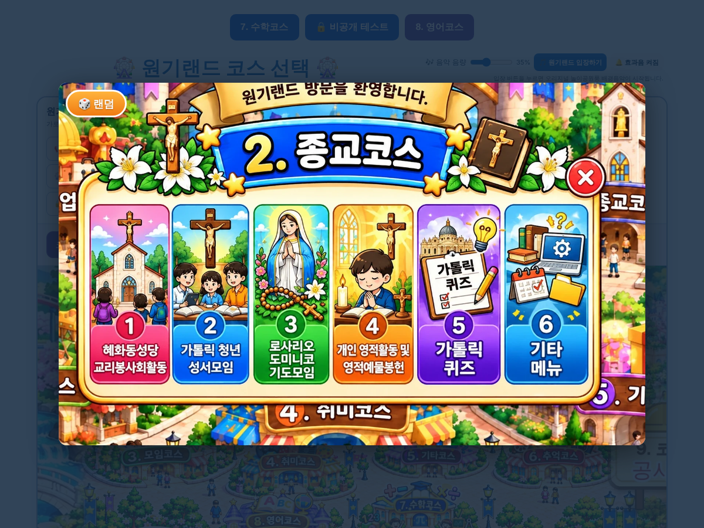

# 원기랜드 100차 — 종교코스 🎲 랜덤 버튼

## 올리는 방법

**HTML 하나만 올리면 됩니다(새 그림 없음).**
- **[웰컴투 원기랜드.html](https://github.com/changdkand3-pixel/-/raw/claude/adoring-darwin-mewhr1/wonkiland-v100/%EC%9B%B0%EC%BB%B4%ED%88%AC%20%EC%9B%90%EA%B8%B0%EB%9E%9C%EB%93%9C.html)** → `드래곤볼 수학게임` 폴더에 이름 그대로 덮어 올립니다.

전체: [wonkiland_v100_neocities.zip](https://github.com/changdkand3-pixel/-/raw/claude/adoring-darwin-mewhr1/wonkiland-v100/wonkiland_v100_neocities.zip). **서버 코드:** 바꿀 것 없음

## 바뀐 점 (99차 → 100차)

1. **2. 종교코스 창** 왼쪽 위에 **🎲 랜덤** 버튼이 생겼습니다. 누를 때마다 ①~⑥ 메뉴 중 하나를 골라 주고, 그 메뉴의 세부 창이 열립니다.
2. 세부 창 6개(혜화동성당·청년 성서모임·로사리오·개인 영적활동·가톨릭 퀴즈·기타 메뉴)에도 왼쪽 위에 **🎲 랜덤** 버튼이 있어서 항목을 랜덤으로 고를 수 있습니다.
3. 결과 글자에 고른 메뉴와 세부 항목까지 나옵니다.
4. 100차 업데이트 안내 카드.

