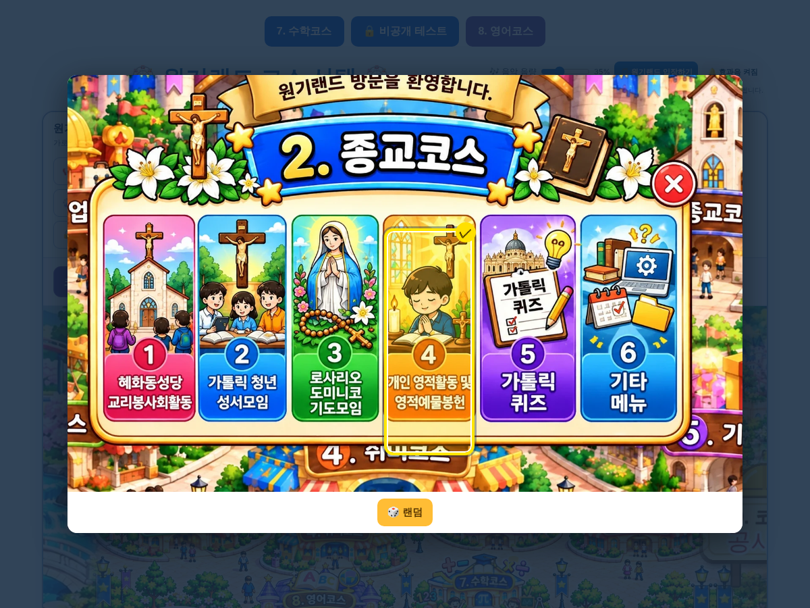

# 원기랜드 101차 — 종교코스 랜덤 버튼 아래로·계속 뽑기·효과음

## 올리는 방법

**HTML 하나만 올리면 됩니다(새 그림 없음).**
- **[웰컴투 원기랜드.html](https://github.com/changdkand3-pixel/-/raw/claude/adoring-darwin-mewhr1/wonkiland-v101/%EC%9B%B0%EC%BB%B4%ED%88%AC%20%EC%9B%90%EA%B8%B0%EB%9E%9C%EB%93%9C.html)** → `드래곤볼 수학게임` 폴더에 이름 그대로 덮어 올립니다.

전체: [wonkiland_v101_neocities.zip](https://github.com/changdkand3-pixel/-/raw/claude/adoring-darwin-mewhr1/wonkiland-v101/wonkiland_v101_neocities.zip). **서버 코드:** 바꿀 것 없음

## 바뀐 점 (100차 → 101차)

1. **안 될 때가 있던 문제:** 100차에서는 종교코스 랜덤을 누르면 세부 창이 위로 열려서 종교코스 창의 랜덤 버튼을 가렸고, 같은 메뉴가 또 뽑히면 바뀐 게 없어 보였습니다.
   - 이제 종교코스 창 랜덤은 **메뉴와 세부 항목까지 골라서 결과에만 표시**하고 세부 창은 열지 않습니다. 계속 눌러서 다시 뽑을 수 있습니다.
   - **매번 바로 앞과 다른 메뉴**가 나옵니다(30번 연속 시험: 같은 메뉴 0번).
   - 뽑힌 메뉴를 직접 누르면 그 세부 창이 열립니다.
2. **랜덤 버튼 위치:** 다른 코스처럼 그림 **아래 가운데**로 옮겼습니다. 세부 창 6개도 같습니다.
3. **효과음:** 랜덤 버튼을 누르면 다른 코스처럼 클릭음+결과음이 나고, 세부 항목을 누를 때도 클릭음이 납니다.
4. 세로 그림 세부 창(로사리오·개인 영적활동·가톨릭 퀴즈·기타 메뉴)은 랜덤 버튼까지 한 화면에 보이게 조금 줄였습니다.
5. 101차 업데이트 안내 카드.

