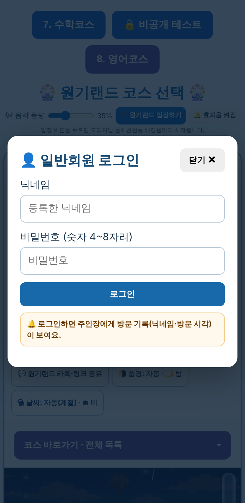

# 원기랜드 103차 — 휴대폰 일반회원 로그인 창

## 올리는 방법

**HTML 하나만 올리면 됩니다(새 그림 없음).**
- **[웰컴투 원기랜드.html](https://github.com/changdkand3-pixel/-/raw/claude/adoring-darwin-mewhr1/wonkiland-v103/%EC%9B%B0%EC%BB%B4%ED%88%AC%20%EC%9B%90%EA%B8%B0%EB%9E%9C%EB%93%9C.html)** → `드래곤볼 수학게임` 폴더에 이름 그대로 덮어 올립니다.

전체: [wonkiland_v103_neocities.zip](https://github.com/changdkand3-pixel/-/raw/claude/adoring-darwin-mewhr1/wonkiland-v103/wonkiland_v103_neocities.zip). **서버 코드:** 바꿀 것 없음

## 바뀐 점 (102차 → 103차)

1. **원인:** 70차에 넣은 안내 문구("🔔 로그인하면 주인장에게 방문 기록이 보여요")가 로그인 창 **안이 아니라 옆에** 붙어서, 휴대폰에서는 창이 반으로 좁아지고 제목이 세 줄로 나뉘었습니다.
2. 안내 문구를 로그인 버튼 아래(창 안)로 옮기고, 로그인 창이 화면 너비에 맞게 넓어지도록 했습니다. 제목 "👤 일반회원 로그인"도 한 줄로 보입니다(360·390px 휴대폰, PC에서 확인).
3. 103차 업데이트 안내 카드.

