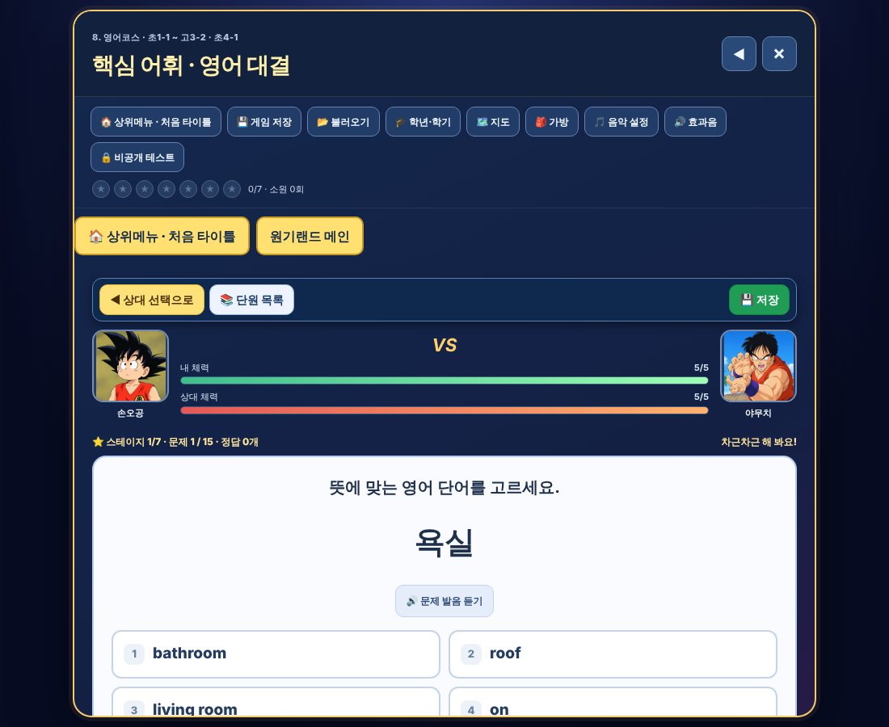

# 원기랜드 105차 — 영어 단원마다 7스테이지 · 독해 단어 문제 고침

## 올리는 방법

**HTML 하나만 올리면 됩니다(새 그림 없음).**
- **[웰컴투 원기랜드.html](https://github.com/changdkand3-pixel/-/raw/claude/adoring-darwin-mewhr1/wonkiland-v105/%EC%9B%B0%EC%BB%B4%ED%88%AC%20%EC%9B%90%EA%B8%B0%EB%9E%9C%EB%93%9C.html)** → `드래곤볼 수학게임` 폴더에 이름 그대로 덮어 올립니다.
- 104차 서버 코드를 아직 안 붙여넣으셨다면 [Code.gs(서버에 붙여넣기).txt](https://github.com/changdkand3-pixel/-/raw/claude/adoring-darwin-mewhr1/wonkiland-v105/Code.gs(%EC%84%9C%EB%B2%84%EC%97%90%20%EB%B6%99%EC%97%AC%EB%84%A3%EA%B8%B0).txt)(104차와 같은 파일)도 붙여넣고 새 버전으로 배포해 주세요.

전체: [wonkiland_v105_neocities.zip](https://github.com/changdkand3-pixel/-/raw/claude/adoring-darwin-mewhr1/wonkiland-v105/wonkiland_v105_neocities.zip)

## 바뀐 점 (104차 → 105차)

1. **영어 단원마다 ⭐ 7스테이지** (모든 학년·학기)
   - 단원(핵심 어휘·문법·표현·독해·문맥 …)마다 스테이지 1~7이 있고, 대결에서 이길 때마다 다음 스테이지로 올라갑니다.
   - 스테이지가 오를수록 상대 체력이 늘어납니다: 1스테이지 5칸 → 2: 6칸 → … → 7스테이지 11칸. 한 판은 최대 15문제, 내 체력은 5칸 그대로입니다.
   - 대결판 단원 제목·전투 화면·결과 화면에 "⭐ 스테이지 N/7"이 보이고, 7스테이지를 이기면 "🏆 7스테이지 완료"가 됩니다.
   - 다음 단원은 예전처럼 앞 단원에서 2명을 이기면 열립니다. 스테이지 기록은 게임 저장·회원 기록에 함께 저장됩니다.
2. **독해 단어 문제 고침:** "지문에서 이 단어의 뜻을 고르세요" 문제가 지문에 없는 단어로도 나왔습니다(예전 643문제 중 상당수). 이제 **지문에 그 단어(복수형·과거형 등 포함)가 실제로 있을 때만** 나옵니다(342문제, 지문에 없는 단어 0개 확인).
3. 105차 업데이트 안내 카드.

