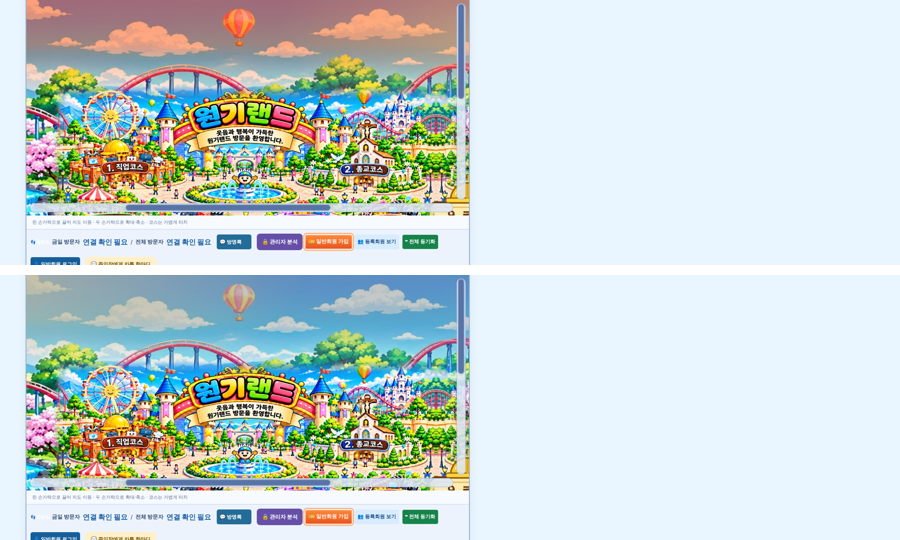

# 원기랜드 106차 — 날씨·시간 색은 하늘에만

## 올리는 방법

**HTML 하나만 올리면 됩니다(새 그림 없음).**
- **[웰컴투 원기랜드.html](https://github.com/changdkand3-pixel/-/raw/claude/adoring-darwin-mewhr1/wonkiland-v106/%EC%9B%B0%EC%BB%B4%ED%88%AC%20%EC%9B%90%EA%B8%B0%EB%9E%9C%EB%93%9C.html)** → `드래곤볼 수학게임` 폴더에 이름 그대로 덮어 올립니다.

전체: [wonkiland_v106_neocities.zip](https://github.com/changdkand3-pixel/-/raw/claude/adoring-darwin-mewhr1/wonkiland-v106/wonkiland_v106_neocities.zip). **서버 코드:** 바꿀 것 없음

## 바뀐 점 (105차 → 106차)

1. 오전·오후·저녁(노을)과 흐림·비·눈의 색이 **지도 위쪽 하늘에만** 입혀집니다. 코스 그림(직업·종교·모임·취미·기타·추억·수학·영어 코스)과 공원은 **원래 그림 색 그대로**입니다.
   - 시험: 저녁·흐림·비일 때 코스 그림 부분 색 변화 0, 하늘 부분만 바뀜.
2. 저녁에 건물에 주황빛을 두르던 것도 없앴습니다.
3. **밤**은 예전처럼 지도 전체가 어두워지고 별·달·불빛이 나옵니다.
4. 비·눈·낙엽·꽃잎이 내리는 움직임은 그대로입니다.
5. 106차 업데이트 안내 카드.

