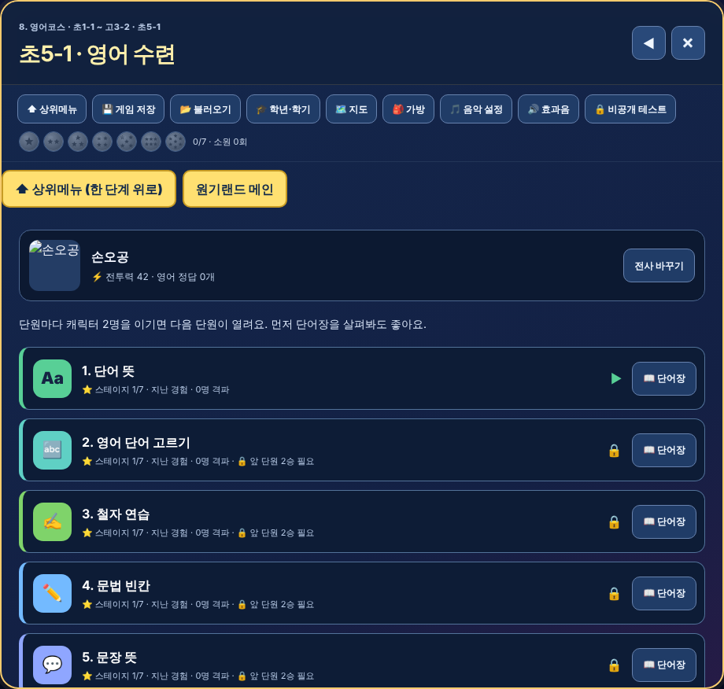

# 원기랜드 107차 — 영어 7단원 · 드래곤볼 1~7성구 · 아이템 100가지

## 올리는 방법

**HTML 하나만 올리면 됩니다(새 그림 없음).**
- **[웰컴투 원기랜드.html](https://github.com/changdkand3-pixel/-/raw/claude/adoring-darwin-mewhr1/wonkiland-v107/%EC%9B%B0%EC%BB%B4%ED%88%AC%20%EC%9B%90%EA%B8%B0%EB%9E%9C%EB%93%9C.html)** → `드래곤볼 수학게임` 폴더에 이름 그대로 덮어 올립니다.

전체: [wonkiland_v107_neocities.zip](https://github.com/changdkand3-pixel/-/raw/claude/adoring-darwin-mewhr1/wonkiland-v107/wonkiland_v107_neocities.zip). **서버 코드:** 바꿀 것 없음

## 바뀐 점 (106차 → 107차)

1. **영어 학기마다 7단원** (초1-2 ~ 고3-2, 23개 학기)
   - 초·중: ① 단어 뜻 ② 영어 단어 고르기 ③ 철자 연습 ④ 문법 빈칸 ⑤ 문장 뜻 ⑥ 영작하기 ⑦ 독해·문맥
   - 고등(수능): ① 수능 어휘 뜻 ② 수능 어휘 고르기 ③ 어휘 철자 ④ 수능 어법 ⑤ 구문 해석 ⑥ 수능 유형 독해 ⑦ 수능 듣기 대비
   - 단원마다 105차의 ⭐ 7스테이지는 그대로입니다. 그림 대결판(초2-1·2-2·3-1·3-2·4-1)도 7단원으로 나옵니다(7단원은 6번째 그림 줄을 함께 씀). 초1-1은 원래 5단원 그대로.
   - **예전 단원 기록(격파·스테이지)은 단원 번호가 바뀌어 새로 시작합니다.** 드래곤볼·소원·승리·정답 수·친구·아이템은 그대로 남습니다.
2. **드래곤볼 1~7성구:** 위쪽 드래곤볼 7개에 별이 1개~7개 그려집니다(모은 공은 밝게, 아직 못 모은 공은 흐리게).
3. **보기가 미리 골라져 보이던 것 고침:** 문제가 나올 때 첫 번째 보기에 자동으로 초점이 가서 고른 것처럼 보였습니다. 이제 아무 보기도 표시되지 않고, 휴대폰에서 누른 자리 표시가 다음 문제에 남지 않습니다.
4. **⬆ 상위메뉴:** 문제 푸는 중에 누르면 처음 화면이 아니라 **바로 윗단계**(상대 고르기 → 단원 목록 → 학기 → …)로 갑니다.
5. **아이템 102가지:** 회복(크림빵·김밥·무지개 물약…), 방어(거북 갑옷·근두운…), 강화(로켓 펀치·용권 비급…), 힌트(돋보기·수정 구슬…) 등 53가지를 더했습니다.
6. **아이템 획득 창:** 창(아이템)을 누르면 바로 닫힙니다.
7. 107차 업데이트 안내 카드.

