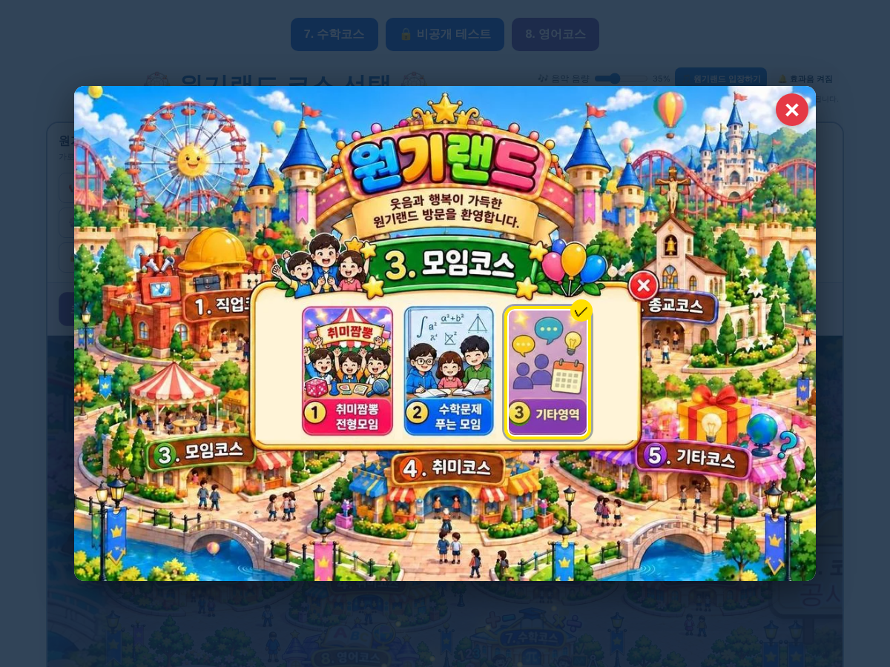

# 원기랜드 110차 — 모임코스 3칸

## 올리는 방법 (파일 2개)

1. **새 그림 1개 → `작업장` 폴더**: **[57a023292227d3.webp](https://github.com/changdkand3-pixel/-/raw/claude/adoring-darwin-mewhr1/wonkiland-v110/57a023292227d3.webp)** (모임코스 그림)
   - 109차 그림 110개를 아직 안 올리셨다면 [109차 안내](../wonkiland-v109/README.md)의 zip도 함께 올려 주세요.
2. **HTML → `드래곤볼 수학게임` 폴더**: **[웰컴투 원기랜드.html](https://github.com/changdkand3-pixel/-/raw/claude/adoring-darwin-mewhr1/wonkiland-v110/%EC%9B%B0%EC%BB%B4%ED%88%AC%20%EC%9B%90%EA%B8%B0%EB%9E%9C%EB%93%9C.html)** 을 이름 그대로 덮어 올립니다.

전체: [wonkiland_v110_neocities.zip](https://github.com/changdkand3-pixel/-/raw/claude/adoring-darwin-mewhr1/wonkiland-v110/wonkiland_v110_neocities.zip). **서버 코드:** 바꿀 것 없음

**이번에 새로 생긴 그림 파일 (작업장에 올릴 것):**
- `57a023292227d3.webp` — 모임코스 3칸 그림

## 바뀐 점 (109차 → 110차)

1. 3. 모임코스에서 ③번 모임 메뉴를 뺐습니다. 그림에서도 그 칸을 지우고 남은 3칸(① 취미짬뽕 전형모임 · ② 수학문제 푸는 모임 · ③ 기타영역)을 가운데로 모았습니다. 기타영역 번호는 4 → 3.
2. 랜덤 뽑기에서도 더 이상 나오지 않습니다(300번 시험).
3. 110차 업데이트 안내 카드.

