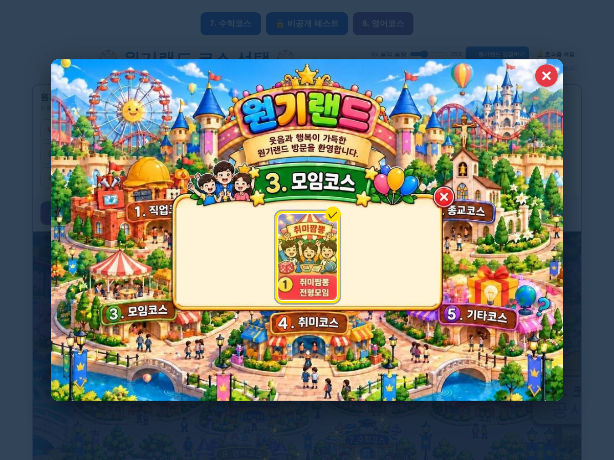

# 원기랜드 111차 — 모임코스는 취미짬뽕 전형모임만

## 올리는 방법 (파일 2개)

1. **새 그림 1개 → `작업장` 폴더**: **[cb267527ae6839.webp](https://github.com/changdkand3-pixel/-/raw/claude/adoring-darwin-mewhr1/wonkiland-v111/cb267527ae6839.webp)** (모임코스 그림). 110차 모임코스 그림 `57a023292227d3.webp`는 이제 쓰지 않으니 안 올려도 됩니다.
   - 109차 그림 110개를 아직 안 올리셨다면 [109차 안내](../wonkiland-v109/README.md)의 zip도 함께 올려 주세요.
2. **HTML → `드래곤볼 수학게임` 폴더**: **[웰컴투 원기랜드.html](https://github.com/changdkand3-pixel/-/raw/claude/adoring-darwin-mewhr1/wonkiland-v111/%EC%9B%B0%EC%BB%B4%ED%88%AC%20%EC%9B%90%EA%B8%B0%EB%9E%9C%EB%93%9C.html)** 을 이름 그대로 덮어 올립니다.

전체: [wonkiland_v111_neocities.zip](https://github.com/changdkand3-pixel/-/raw/claude/adoring-darwin-mewhr1/wonkiland-v111/wonkiland_v111_neocities.zip). **서버 코드:** 바꿀 것 없음

**이번에 새로 생긴 그림 파일 (작업장에 올릴 것):**
- `cb267527ae6839.webp` — 모임코스 그림(취미짬뽕 전형모임 1칸)

## 바뀐 점 (110차 → 111차)

1. 3. 모임코스에서 **수학문제 푸는 모임**과 **기타영역**도 뺐습니다. 이제 **① 취미짬뽕 전형모임**만 가운데에 남았습니다(그림에서도 다른 칸을 지움).
2. 랜덤 뽑기에서도 뺀 모임은 나오지 않습니다(300번 시험).
3. 111차 업데이트 안내 카드.

