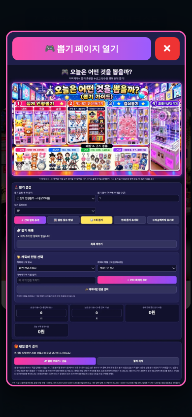

# 원기랜드 113차 — 인형뽑기과 → "오늘은 어떤 것을 뽑을까?" 페이지

## 올리는 방법 (파일 2개)

1. **새 그림 1개 → `작업장` 폴더**: **[6e9e63056647ce.webp](https://github.com/changdkand3-pixel/-/raw/claude/adoring-darwin-mewhr1/wonkiland-v113/6e9e63056647ce.webp)** (뽑기 페이지 그림)
   - 112차 그림 `337404a9b7cdac.webp`도 아직 안 올리셨다면 함께 올려 주세요.
2. **HTML → `드래곤볼 수학게임` 폴더**: **[웰컴투 원기랜드.html](https://github.com/changdkand3-pixel/-/raw/claude/adoring-darwin-mewhr1/wonkiland-v113/%EC%9B%B0%EC%BB%B4%ED%88%AC%20%EC%9B%90%EA%B8%B0%EB%9E%9C%EB%93%9C.html)** 을 이름 그대로 덮어 올립니다.

전체: [wonkiland_v113_neocities.zip](https://github.com/changdkand3-pixel/-/raw/claude/adoring-darwin-mewhr1/wonkiland-v113/wonkiland_v113_neocities.zip). **서버 코드:** 바꿀 것 없음

**이번에 새로 생긴 그림 파일 (작업장에 올릴 것):**
- `6e9e63056647ce.webp` — "오늘은 어떤 것을 뽑을까?" 페이지 그림

## 바뀐 점 (112차 → 113차)

1. 모임코스 → 취미짬뽕 전형모임 → **인형뽑기과**를 누르면(그림 속 인형뽑기 기계나 지원과 목록) 보내 주신 **"오늘은 어떤 것을 뽑을까?" 그림 창**이 열립니다.
2. 창 위 **🎮 뽑기 페이지 열기** 버튼이나 그림을 누르면 [네오시티 뽑기 페이지](https://hinsrolin.neocities.org/%EB%AC%B4%EC%97%87%EC%9D%84%20%EB%BD%91%EC%9D%84%EA%B9%8C%3F)가 새 창으로 열립니다. ✕·바깥 누르기·Esc로 닫힙니다.
3. **메인 화면 랜덤 뽑기**와 취미짬뽕 창의 🎲 랜덤에서 인형뽑기과가 나와도 이 창이 열립니다.
4. 113차 업데이트 안내 카드.

