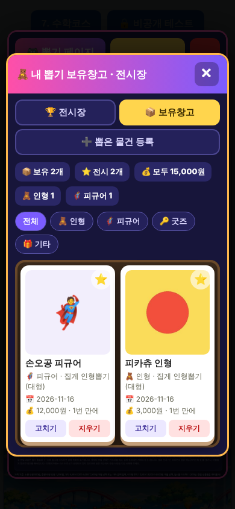

# 원기랜드 114차 — 뽑은 물건 보유창고 · 전시장

## 올리는 방법

**HTML 하나만 올리면 됩니다(새 그림 없음).**
- **[웰컴투 원기랜드.html](https://github.com/changdkand3-pixel/-/raw/claude/adoring-darwin-mewhr1/wonkiland-v114/%EC%9B%B0%EC%BB%B4%ED%88%AC%20%EC%9B%90%EA%B8%B0%EB%9E%9C%EB%93%9C.html)** → `드래곤볼 수학게임` 폴더에 덮어 올리기.
- 113차 그림 `6e9e63056647ce.webp`를 아직 안 올리셨다면 `작업장` 폴더에 함께 올려 주세요.

전체: [wonkiland_v114_neocities.zip](https://github.com/changdkand3-pixel/-/raw/claude/adoring-darwin-mewhr1/wonkiland-v114/wonkiland_v114_neocities.zip). **서버 코드:** 바꿀 것 없음

## 바뀐 점 (113차 → 114차)

1. 모임코스 → 취미짬뽕 전형모임 → **인형뽑기과** 창 위에 **🧸 내 보유창고** 버튼이 생겼습니다.
2. **➕ 뽑은 물건 등록**: 물건 이름, 종류(인형·피규어·굿즈·기타), 뽑은 방법(집게 대·중·소형, 가챠, 이치방쿠지, 열쇠뽑기, UFO 등), 쓴 돈, 몇 번 만에, 뽑은 날, 뽑은 곳, 사진(선택).
3. **📦 보유창고**: 모은 물건 전체(종류별로 골라 보기), 고치기·지우기, 보유 개수·전시 개수·쓴 돈 합계.
4. **🏆 전시장**: ⭐를 누른 물건만 나무 진열대에 전시합니다. ☆/⭐를 눌러 올리고 내립니다.
5. 기록은 이 기기에 저장되고, **일반회원으로 로그인하면 목록은 회원 기록과 함께 클라우드에 저장**되어 다른 기기에서도 보입니다. 사진은 용량 때문에 그 기기에만 저장됩니다.
6. 114차 업데이트 안내 카드.

