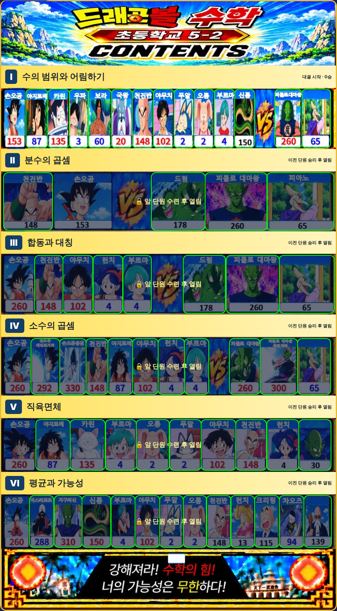

# 원기랜드 115차 — 초5-2 수학·영어

## 올리는 방법

1. **새 그림 110개 → `작업장` 폴더**
   - **[wonkiland_v115_새그림110개.zip](https://github.com/changdkand3-pixel/-/raw/claude/adoring-darwin-mewhr1/wonkiland-v115/wonkiland_v115_%EC%83%88%EA%B7%B8%EB%A6%BC110%EA%B0%9C.zip)** 을 풀어 그림을 모두 골라 `작업장` 폴더에 한 번에 끌어다 올립니다.
2. **HTML → `드래곤볼 수학게임` 폴더**
   - **[웰컴투 원기랜드.html](https://github.com/changdkand3-pixel/-/raw/claude/adoring-darwin-mewhr1/wonkiland-v115/%EC%9B%B0%EC%BB%B4%ED%88%AC%20%EC%9B%90%EA%B8%B0%EB%9E%9C%EB%93%9C.html)** 을 이름 그대로 덮어 올립니다.

전체: [wonkiland_v115_neocities.zip](https://github.com/changdkand3-pixel/-/raw/claude/adoring-darwin-mewhr1/wonkiland-v115/wonkiland_v115_neocities.zip). **서버 코드:** 바꿀 것 없음

## 바뀐 점 (114차 → 115차)

1. **수학 초5-2**: `초5-2.pdf` 원본 100문항(다른 학년 문제 없음), 정답은 빠른정답에서 숫자만(43번은 ③, ⑤ 두 개).
   - Ⅰ 수의 범위와 어림하기(15) · Ⅱ 분수의 곱셈(21) · Ⅲ 합동과 대칭(17) · Ⅳ 소수의 곱셈(2) · Ⅴ 직육면체(31) · Ⅵ 평균과 가능성(14)
   - PDF에 단원이 섞여 있어 문제 내용으로 나눴습니다(96~98번 어림 → Ⅰ, 99·100번 남은 부분 → Ⅱ). **소수의 곱셈 문제는 PDF에 2개(49·50번)뿐**이라 Ⅳ단원은 같은 문제가 자주 나옵니다.
   - `5-2` 폴더 목차 그림 대결판, 캐릭터 27명(손오공 4가지·야지로베·카린·우파·보라·국왕·천진반·야무치·푸알·오룡·부르마·신룡·피콜로 대마왕 2가지·꼬마 피콜로·피아노·드럼·런치 2가지·미스터 포포·지구의 신·크리링·차오즈·무천도사)
2. **영어 초5-2**: 같은 목차 그림과 캐릭터로 7단원 대결판(문제는 단원마다 약 300개).
3. 115차 업데이트 안내 카드.

**이번에 새로 생긴 그림 파일 (작업장에 올릴 것, 110개):**
- `047bb2b1132d82.webp`
- `05d6898f3f6747.webp`
- `08871f45f6c5d7.webp`
- `0af985ce124cd7.webp`
- `0c611ebc23ea2c.webp`
- `1139436a42fc56.webp`
- `1256744e276efa.webp`
- `12908e6c802442.webp`
- `15c38fea92faee.webp`
- `19abf2159b716d.webp`
- `19bccbe50e4f05.webp`
- `19c36dd4a1e294.webp`
- `1ba8924f2eb7a2.webp`
- `235f776a66c166.webp`
- `255d760c3366f4.webp`
- `256ea04aa6b4fd.webp`
- `25bc76afb95b7f.webp`
- `26ae93762e19f0.webp`
- `2c94166a577f1e.webp`
- `2d9745ca087c78.webp`
- `2e18e03b792bab.webp`
- `2e85aebc6289da.webp`
- `2f06766e6e77d0.webp`
- `2f7068404cf959.webp`
- `313f37b266457d.webp`
- `3573148bc651df.webp`
- `385c75244b74af.webp`
- `3c6522f0081b3b.webp`
- `3e1f9cbe78505a.webp`
- `3ee2966abd9fa4.webp`
- `42fb1e6f2a20d5.webp`
- `49af2a61f3e2d4.webp`
- `4cf9a5f1e77f47.webp`
- `4ddffd5552be98.webp`
- `522afd13da3aaa.webp`
- `544eb5e571e2dc.webp`
- `55d8d7cc739727.webp`
- `56c01056df952f.webp`
- `57456b1869d50a.webp`
- `5a189d964077b7.webp`
- `631fcfa66ea869.webp`
- `65d9887e834b7d.webp`
- `714e4819057c86.webp`
- `7203ea63f3d59c.webp`
- `746270d9b3adb7.webp`
- `79e35cd737c0d3.webp`
- `7adc786ae241ce.webp`
- `7fa89ba056fadc.webp`
- `814cf6c438f57e.webp`
- `848e9b26bc90c9.webp`
- `8590a7b24a1eaa.webp`
- `8595a2071c7b76.webp`
- `896bb286350ab4.webp`
- `8dcac1b8fea6bc.webp`
- `8f375ea5541e39.webp`
- `8ff4aa0143f8c1.webp`
- `91154544b3882c.webp`
- `97d60a4c1ebc2e.webp`
- `97ddcee3d20899.webp`
- `9885875f946800.webp`
- `9a52f9103895d4.webp`
- `9a5a30d4a13bb2.webp`
- `9a8ecb71343438.webp`
- `9c0636ae2efed0.webp`
- `9c7273edf744cd.webp`
- `9d998967b5bfd4.webp`
- `a04dd8d0df822f.webp`
- `a55ca16109ac5a.webp`
- `a7302815f702cc.webp`
- `abcf145987359e.webp`
- `ac0f9f0690bcae.webp`
- `ad7fd4ff7232cf.webp`
- `ae372c63c72806.webp`
- `ae8da33f610c49.webp`
- `aec7cb4c439c7a.webp`
- `afa2fea5243bfc.webp`
- `b044a4727a5f06.webp`
- `b3b572cc857223.webp`
- `b6c1058fed7a3c.webp`
- `b72c627256d715.webp`
- `bab9b739bdacfb.webp`
- `be5d16b544ed4f.webp`
- `c1a285b80dbaf3.webp`
- `c6da9a2b412e34.webp`
- `cb600c62267833.webp`
- `cd33831ab2a902.webp`
- `cdb8f008e0452d.webp`
- `cfc16954c5d843.webp`
- `d43dd6d4fba73b.webp`
- `d46b6f85f43c26.webp`
- `d543d2decfb8f4.webp`
- `d5da8cb1a2aa97.webp`
- `d762b18e21e57a.webp`
- `d8044bb8e69b54.webp`
- `dc1b5529151379.webp`
- `dc2ff81dee62d0.webp`
- `e0ff03d71af929.webp`
- `e10bf4f8595b87.webp`
- `e55eae909fb594.webp`
- `e7f2c1b03795cd.webp`
- `e8923938d6b19b.webp`
- `ec71a89d294672.webp`
- `ec776d5ad3d086.webp`
- `ecf5de9b7562a4.webp`
- `f07231b474816c.webp`
- `f4f080293d5169.webp`
- `f5803d06951688.webp`
- `f920f4e31bb9d8.webp`
- `fb7091a849a0e0.webp`
- `ffde6be1f82fab.webp`
