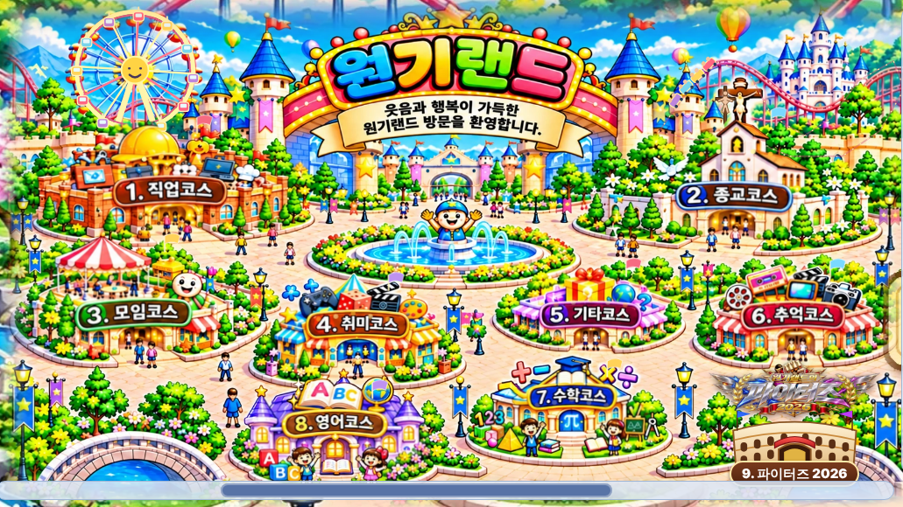
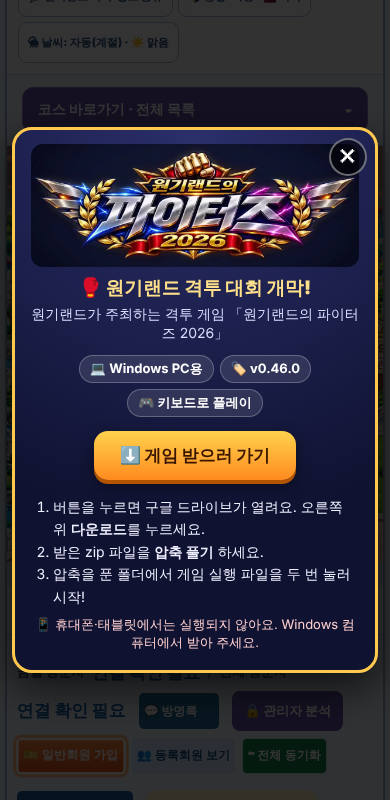

# 원기랜드 116차 — 메인 지도에 「9. 파이터즈 2026」 경기장

## 올리는 방법

1. **새 그림 2개 → `작업장` 폴더**: `0519295c320de0.webp`, `9d7baee4de6d2c.webp` (파이터즈 로고·간판)
2. **HTML → `드래곤볼 수학게임` 폴더**: **[웰컴투 원기랜드.html](https://github.com/changdkand3-pixel/-/raw/claude/adoring-darwin-mewhr1/wonkiland-v116/%EC%9B%B0%EC%BB%B4%ED%88%AC%20%EC%9B%90%EA%B8%B0%EB%9E%9C%EB%93%9C.html)** 을 이름 그대로 덮어 올립니다.
3. **꼭 해 주세요 — 구글 드라이브 공유 열기**: 드라이브에서 `WongilandFighters2026-Windows-v0.46.0.zip` → 공유 → 일반 액세스를 **"링크가 있는 모든 사용자"(뷰어)** 로 바꿔야 방문자가 게임을 받을 수 있습니다. (지금은 로그인 화면이 떠서 남은 받을 수 없음)

전체: [wonkiland_v116_neocities.zip](https://github.com/changdkand3-pixel/-/raw/claude/adoring-darwin-mewhr1/wonkiland-v116/wonkiland_v116_neocities.zip). **서버 코드:** 바꿀 것 없음. (115차 새 그림 110개를 아직 안 올리셨다면 [115차 안내](../wonkiland-v115/README.md)대로 먼저 올려 주세요.)

## 바뀐 점 (115차 → 116차)

1. 메인 지도 오른쪽 아래(6. 추억코스 아래)에 **「9. 파이터즈 2026」 경기장** 건물이 생겼습니다. 영상 속 로고를 간판으로 쓰고, 경기장은 새로 그렸습니다(캐릭터 그림은 넣지 않음).
2. 누르면 **게임 소개 창**: 로고, "원기랜드 격투 대회 개막!", Windows PC용 · v0.46.0, **⬇️ 게임 받으러 가기**(구글 드라이브 새 창), 받는 방법 3단계, 휴대폰에서는 실행 안 된다는 안내. ✕ · 바깥 누르기 · Esc로 닫힘.
3. 코스 창이 열리면 경기장은 잠시 숨김.
4. 116차 업데이트 안내 카드.

새 버전(v0.47 등)을 드라이브에 올리면 주소와 버전을 알려 주세요. `build-tools/assets/fighters-116.html`의 `GAME` 한 줄만 바꾸면 됩니다.

**이번에 새로 생긴 그림 파일 (작업장에 올릴 것, 2개):**
- `0519295c320de0.webp`
- `9d7baee4de6d2c.webp`
