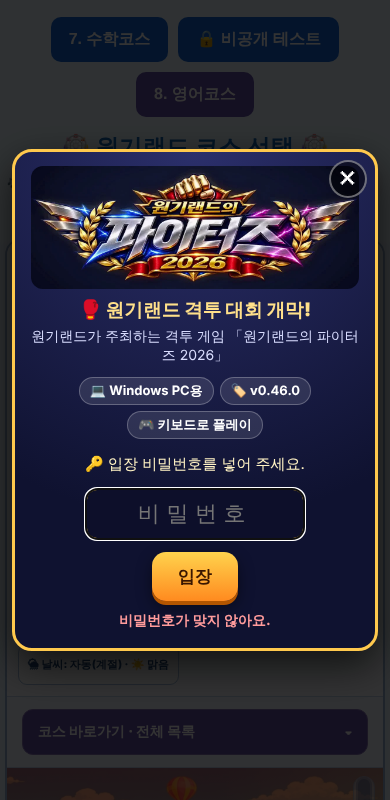

# 원기랜드 117차 — 파이터즈 2026은 회원 전용 + 비밀번호

## 올리는 방법

**HTML 하나만 올리면 됩니다(새 그림 없음).**
- **[웰컴투 원기랜드.html](https://github.com/changdkand3-pixel/-/raw/claude/adoring-darwin-mewhr1/wonkiland-v117/%EC%9B%B0%EC%BB%B4%ED%88%AC%20%EC%9B%90%EA%B8%B0%EB%9E%9C%EB%93%9C.html)** → `드래곤볼 수학게임` 폴더에 덮어 올리기.
- 116차 새 그림 2개(`0519295c320de0.webp`, `9d7baee4de6d2c.webp`)를 아직 안 올리셨다면 `작업장` 폴더에 함께 올려 주세요.

전체: [wonkiland_v117_neocities.zip](https://github.com/changdkand3-pixel/-/raw/claude/adoring-darwin-mewhr1/wonkiland-v117/wonkiland_v117_neocities.zip). **서버 코드:** 바꿀 것 없음

## 바뀐 점 (116차 → 117차)

1. 메인 지도 **9. 파이터즈 2026** 경기장을 누르면:
   - **방문자(로그인 안 함)**: "방문자는 입장할 수 없어요" + **👤 일반회원 로그인** 버튼(누르면 로그인 창이 열림). 받기 버튼은 없음.
   - **일반회원 로그인 / 주인장 기기**: 입장 비밀번호 칸 → **4288**을 넣으면 **⬇️ 게임 받으러 가기** 버튼이 나옴. 틀리면 "비밀번호가 맞지 않아요." 창을 열 때마다 다시 물음.
2. 게임 받기 주소는 HTML 안에 그대로 쓰지 않고 비밀번호로 섞어 두어서, 비밀번호를 넣어야 주소가 나옵니다.
3. 117차 업데이트 안내 카드.

> 참고: 구글 드라이브 파일 공유가 "링크가 있는 모든 사용자"이면, 주소를 아는 사람은 누구나 받을 수 있습니다. 원기랜드 화면의 막기는 주소를 숨기는 정도입니다. 비밀번호·주소를 바꾸려면 `build-tools/patch.py`의 `_fi_pw`·`_fi_url` 두 줄만 바꾸고 다시 만들면 됩니다.

