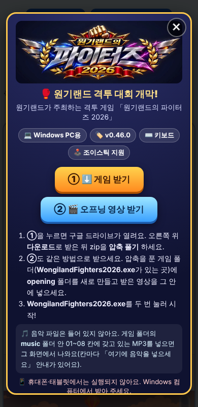

# 원기랜드 119차 — 파이터즈 2026 오프닝 영상도 함께 받기

## 올리는 방법

**HTML 하나만 올리면 됩니다(새 그림 없음).**
- **[웰컴투 원기랜드.html](https://github.com/changdkand3-pixel/-/raw/claude/adoring-darwin-mewhr1/wonkiland-v119/%EC%9B%B0%EC%BB%B4%ED%88%AC%20%EC%9B%90%EA%B8%B0%EB%9E%9C%EB%93%9C.html)** → `드래곤볼 수학게임` 폴더에 덮어 올리기.
- **꼭 해 주세요:** 드라이브의 `원기랜드의 파이터즈 2026 오프닝 최종수정본.mp4` 공유를 **"링크가 있는 모든 사용자"(뷰어)** 로 바꿔 주세요. 지금은 비공개라 ② 버튼을 눌러도 로그인 화면이 뜹니다.

전체: [wonkiland_v119_neocities.zip](https://github.com/changdkand3-pixel/-/raw/claude/adoring-darwin-mewhr1/wonkiland-v119/wonkiland_v119_neocities.zip). **서버 코드:** 바꿀 것 없음

## 바뀐 점 (118차 → 119차)

1. 파이터즈 경기장 소개 창(일반회원·주인장, 비밀번호 4288 입력 후)에 버튼 두 개:
   - **① ⬇️ 게임 받기** — `WongilandFighters2026-Windows-v0.46.0.zip`
   - **② 🎬 오프닝 영상 받기** — `원기랜드의 파이터즈 2026 오프닝 최종수정본.mp4`
2. 받는 방법 안내: 게임 zip 압축 풀기 → `WongilandFighters2026.exe`가 있는 폴더에 `opening` 폴더를 만들고 영상 넣기 → exe 실행.
3. 음악 안내: 음악 파일은 나눠 주지 않고, 게임 폴더 `music` 안 01~08 칸에 각자 MP3를 넣으면 된다고 안내(저작권이 있는 게임 원곡은 나눠 주지 않음).
4. 두 주소 모두 HTML에 그대로 넣지 않고 비밀번호로 섞어 둠(patch.py `_fi_url`·`_fi_url2`·`_fi_pw`).
5. 119차 업데이트 안내 카드.

> 확인해 주세요: 게임 파일을 살펴보니 게임 안의 오프닝은 `opening.ogv`(Ogg 영상)로 들어 있습니다. 게임이 `opening` 폴더의 mp4를 그대로 읽는지는 여기서 확인할 수 없었습니다. 컴퓨터의 `opening` 폴더에 실제로 어떤 파일(이름·확장자)이 들어 있는지 알려 주시면 안내를 맞추겠습니다.

