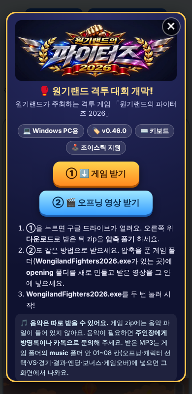

# 원기랜드 120차 — 파이터즈 2026 음악은 따로 받는다는 안내

## 올리는 방법

**HTML 하나만 올리면 됩니다(새 그림 없음).**
- **[웰컴투 원기랜드.html](https://github.com/changdkand3-pixel/-/raw/claude/adoring-darwin-mewhr1/wonkiland-v120/%EC%9B%B0%EC%BB%B4%ED%88%AC%20%EC%9B%90%EA%B8%B0%EB%9E%9C%EB%93%9C.html)** → `드래곤볼 수학게임` 폴더에 덮어 올리기.
- 오프닝 mp4 공유를 아직 안 여셨다면 "링크가 있는 모든 사용자"로 열어 주세요(119차 안내).

전체: [wonkiland_v120_neocities.zip](https://github.com/changdkand3-pixel/-/raw/claude/adoring-darwin-mewhr1/wonkiland-v120/wonkiland_v120_neocities.zip). **서버 코드:** 바꿀 것 없음

## 바뀐 점 (119차 → 120차)

1. 파이터즈 받기 창의 음악 안내를 바꿨습니다: **"🎵 음악은 따로 받을 수 있어요. 게임 zip에는 음악 파일이 들어 있지 않아요. 음악이 필요하면 주인장에게 방명록이나 카톡으로 문의해 주세요."** + music 폴더 01~08 칸(오프닝·캐릭터 선택·VS·경기·결과·엔딩·보너스·게임오버)에 MP3를 넣는 방법.
2. 음악 받기 버튼·링크는 넣지 않았습니다.
3. 120차 업데이트 안내 카드.

