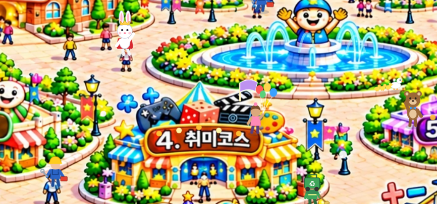
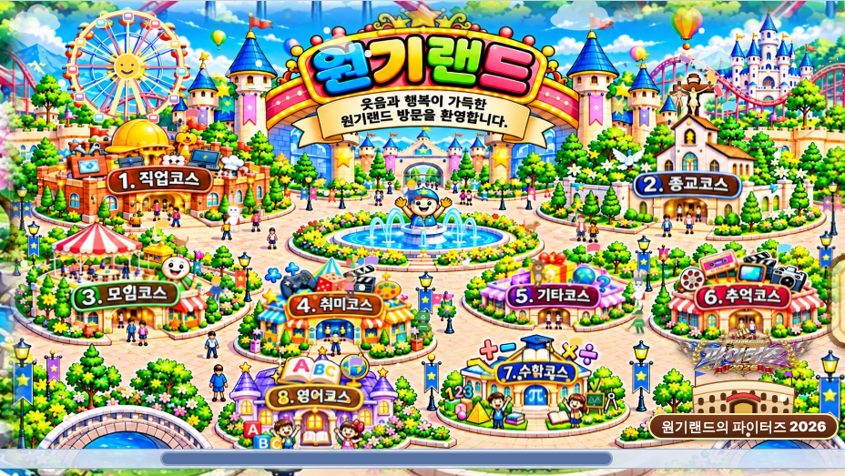

# 원기랜드 121차 — 메인 지도가 살아 움직여요 (구름·새·동물·직원)

## 올리는 방법

**HTML 하나만 올리면 됩니다(새 그림 없음).**
- **[웰컴투 원기랜드.html](https://github.com/changdkand3-pixel/-/raw/claude/adoring-darwin-mewhr1/wonkiland-v121/%EC%9B%B0%EC%BB%B4%ED%88%AC%20%EC%9B%90%EA%B8%B0%EB%9E%9C%EB%93%9C.html)** → `드래곤볼 수학게임` 폴더에 덮어 올리기.

전체: [wonkiland_v121_neocities.zip](https://github.com/changdkand3-pixel/-/raw/claude/adoring-darwin-mewhr1/wonkiland-v121/wonkiland_v121_neocities.zip). **서버 코드:** 바꿀 것 없음

## 바뀐 점 (120차 → 121차)

메인 지도 위에 새 움직임 층(`assets/life-121.html`, 그림 파일 없이 새로 그린 SVG)을 얹었습니다. 기존 방문객은 그대로 다닙니다.

1. **하늘**: ☁️ 구름 5개가 천천히 흘러가고, 🐦 새 무리 3개가 날갯짓하며 날아갑니다.
2. **동물**: 🐶 강아지 2마리(꼬리 흔들기), 🐱 고양이, 🦆 분수에서 헤엄치는 오리 엄마와 새끼 3마리, 🐰 깡충깡충 토끼.
3. **직원**:
   - 🐰 **원기랜드 토끼 탈인형** 2명(흰 토끼·왕관·빨간 W 망토, 손 흔들기), 🐻 곰 탈인형
   - 🔧 **정비사** 2명(노란 안전모·파란 작업복·스패너·공구상자)
   - 🧹 **청소부** 2명(초록 작업복·빗자루 쓸기, 한 명은 ♻ 수레를 끌고 다님)
   - 🚩 **안내원**(빨간 조끼·깃발), 🎈 **풍선 판매원**
4. 직원·동물은 광장·분수 앞·코스 사이 길로 오가며 가는 방향을 바라봅니다.
5. 지도 도구의 **🎡 놀이공원 움직임 끄기**를 누르면 같이 멈추고, 다시 켜면 움직입니다. 지도 누르기(코스 선택)는 막지 않습니다. 화면을 안 볼 때는 쉬어서 배터리를 아낍니다.
6. 121차 업데이트 안내 카드.

