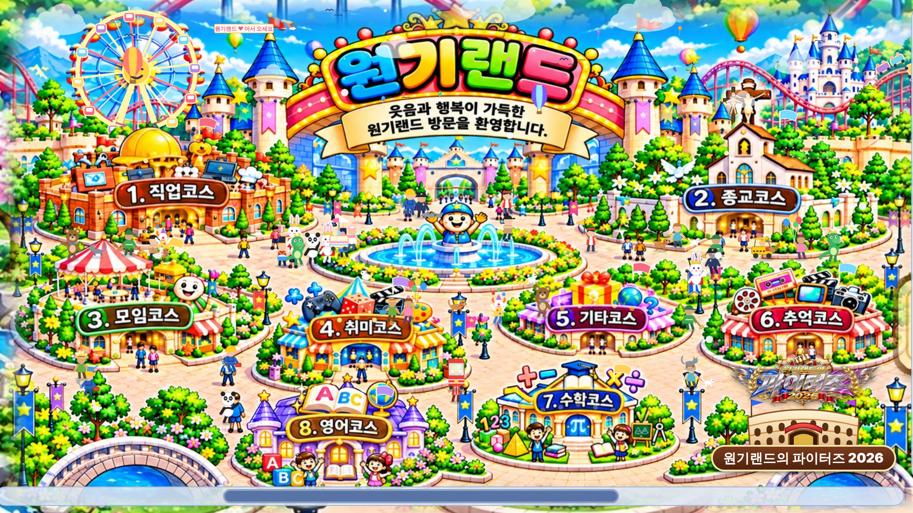

# 원기랜드 122차 — 메인 지도를 아주 풍성하게 (움직이는 친구 90개 넘게)

## 올리는 방법

**HTML 하나만 올리면 됩니다(새 그림 없음).**
- **[웰컴투 원기랜드.html](https://github.com/changdkand3-pixel/-/raw/claude/adoring-darwin-mewhr1/wonkiland-v122/%EC%9B%B0%EC%BB%B4%ED%88%AC%20%EC%9B%90%EA%B8%B0%EB%9E%9C%EB%93%9C.html)** → `드래곤볼 수학게임` 폴더에 덮어 올리기.

전체: [wonkiland_v122_neocities.zip](https://github.com/changdkand3-pixel/-/raw/claude/adoring-darwin-mewhr1/wonkiland-v122/wonkiland_v122_neocities.zip). **서버 코드:** 바꿀 것 없음

## 바뀐 점 (121차 → 122차)

121차 움직임 층(`assets/life-121.html`)에 많이 더 넣었습니다. 모두 새로 그린 SVG이고 그림 파일은 없습니다. (기존 방문객과 별도로 91개)

**하늘**
- ☁️ 구름 8개, 🐦 새 무리 6개
- 🎈 광장에서 하늘로 날아올라 가는 풍선 7개
- 🎈 천천히 떠다니는 열기구 2개
- ✈️ "원기랜드 ♥ 어서 오세요" 현수막을 단 비행기(가끔 지나감)
- 🦋 꽃밭 위를 팔랑팔랑 나는 나비 9마리

**탈인형·퍼레이드**
- 🐰 원기랜드 토끼, 🐻 곰, 🐼 판다, 🦖 공룡 탈인형
- 🥁 북 치는 단원이 앞장서는 **탈인형 퍼레이드**가 광장을 줄지어 지나감

**직원**
- 🔧 정비사 3명과 🚗 노란 정비 카트
- 🧹 청소부 4명(한 명은 수레를 끌고 다님)
- 🚩 안내원 2명, 👮 경비원 2명
- 🌻 정원사 2명(밀짚모자·물뿌리개)

**판매원·공연**
- 🎈 풍선 판매원 2명
- 🍦 아이스크림 수레, 🍿 팝콘 수레
- 📸 사진사 2명(가끔 플래시가 번쩍)
- 🤡 공 세 개를 저글링하는 광대 2명

**손님·동물**
- 🐕 강아지를 산책시키는 손님 2명
- 🐶 강아지 3마리, 🐱 고양이 2마리
- 🦆 오리 가족 2무리(분수에서 헤엄)
- 🐰 토끼 2마리, 🐿️ 다람쥐 2마리
- 🕊️ 모이를 쪼는 비둘기들

**그 밖에**
- 직원·동물은 코스 건물을 피해 광장·분수 앞·코스 사이 길로 다닙니다. 수레에 적힌 글자는 방향이 바뀔 때 뒤집혀 보여서 그림 무늬로 바꿨습니다.
- **🎡 놀이공원 움직임 끄기**로 함께 멈추고 켤 수 있습니다. 코스 누르기는 막지 않습니다.
- 122차 업데이트 안내 카드를 넣었습니다.

