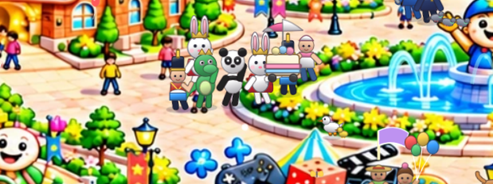
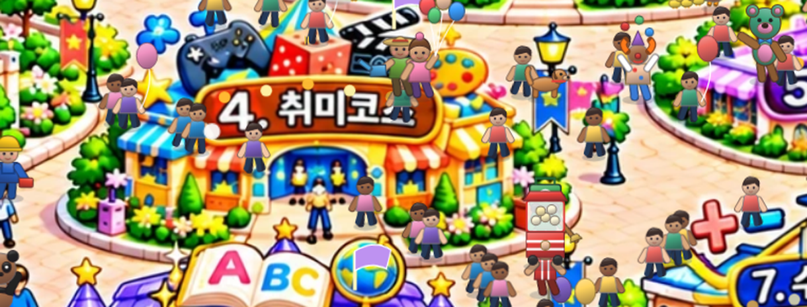

# 원기랜드 123차 — 움직이는 친구들 그림체를 지도 그림과 맞춤

## 올리는 방법

**HTML 하나만 올리면 됩니다(새 그림 없음).**
- **[웰컴투 원기랜드.html](https://github.com/changdkand3-pixel/-/raw/claude/adoring-darwin-mewhr1/wonkiland-v123/%EC%9B%B0%EC%BB%B4%ED%88%AC%20%EC%9B%90%EA%B8%B0%EB%9E%9C%EB%93%9C.html)** → `드래곤볼 수학게임` 폴더에 덮어 올리기.

전체: [wonkiland_v123_neocities.zip](https://github.com/changdkand3-pixel/-/raw/claude/adoring-darwin-mewhr1/wonkiland-v123/wonkiland_v123_neocities.zip). **서버 코드:** 바꿀 것 없음

## 바뀐 점 (122차 → 123차)

움직이는 그림이 단색 도형 느낌이라, 지도 그림 속 사람들처럼 바꿨습니다.

1. **명암**: 옷·피부·머리·탈인형·수레마다 위는 밝고 아래는 어둡게 색이 이어집니다.
2. **테두리**: 각 색보다 진한 색의 부드러운 테두리를 둘렀습니다. 팔·다리도 테두리가 있습니다.
3. **얼굴**: 직원과 손님 얼굴에 눈·발그레한 볼·웃는 입을 넣었습니다.
4. **원래 방문객도 같게**: 예전부터 지도를 걸어 다니던 방문객도 같은 그림체가 됩니다. 방문 수가 바뀌어 다시 그려져도 그대로 유지됩니다.
5. 123차 업데이트 안내 카드.

