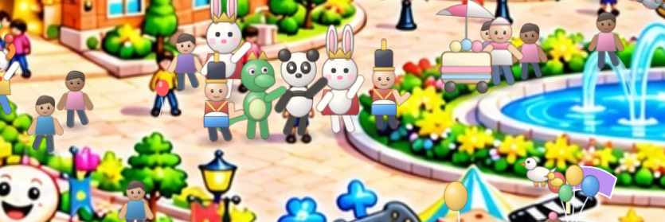
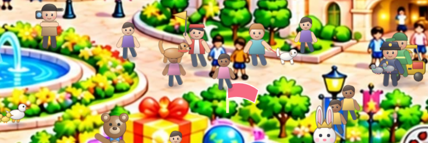

# 원기랜드 125차 — 움직이는 사람·동물을 부드럽고 입체적으로 (포근한 그림책 느낌)

## 올리는 방법

**HTML 하나만 올리면 됩니다(새 그림 없음).**
- **[웰컴투 원기랜드.html](https://github.com/changdkand3-pixel/-/raw/claude/adoring-darwin-mewhr1/wonkiland-v125/%EC%9B%B0%EC%BB%B4%ED%88%AC%20%EC%9B%90%EA%B8%B0%EB%9E%9C%EB%93%9C.html)** → `드래곤볼 수학게임` 폴더에 덮어 올리기.

전체: [wonkiland_v125_neocities.zip](https://github.com/changdkand3-pixel/-/raw/claude/adoring-darwin-mewhr1/wonkiland-v125/wonkiland_v125_neocities.zip). **서버 코드:** 바꿀 것 없음

## 바뀐 점 (124차 → 125차)

부드럽고 따뜻한 손그림 애니메이션 느낌을 냈습니다. 그림 느낌만 맞췄고, 다른 작품의 캐릭터를 그리지는 않았습니다.

1. **입체 명암**: 빛이 왼쪽 위에서 비치는 것처럼 머리·몸통·동물처럼 둥근 곳은 둥글게 밝아졌다 어두워집니다. 옷은 비스듬히 명암이 들어갑니다.
2. **빛 반사**: 큰 머리·몸통에 은은한 하얀 빛 반사를 넣었습니다.
3. **부드러운 선과 색**: 테두리는 얇고 연한 갈색, 색은 크림빛이 살짝 도는 포근한 색으로 바꿨습니다.
4. **번지는 그림자**: 발밑 그림자가 가장자리로 갈수록 번집니다.
5. **반짝이는 눈**: 동그란 눈 대신 세로로 긴 눈에 작은 하이라이트를 넣었습니다.
6. **고친 문제**: 123차부터 직원 층과 방문객 층의 색 이름이 겹쳐 흰 토끼·판다 탈인형이 누렇게 보일 수 있던 문제를 고쳤습니다.
7. 원래 방문객도 같은 그림체가 됩니다. 125차 업데이트 안내 카드.

