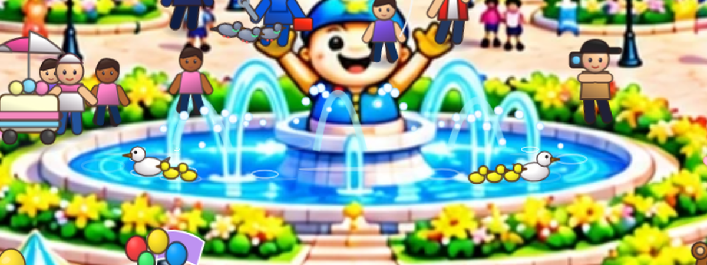

# 원기랜드 127차 — 물이 흐르고, 오리가 헤엄치고, 구름이 흐르고, 꽃잎이 흩날려요

## 올리는 방법

**HTML 하나만 올리면 됩니다(새 그림 없음).**
- **[웰컴투 원기랜드.html](https://github.com/changdkand3-pixel/-/raw/claude/adoring-darwin-mewhr1/wonkiland-v127/%EC%9B%B0%EC%BB%B4%ED%88%AC%20%EC%9B%90%EA%B8%B0%EB%9E%9C%EB%93%9C.html)** → `드래곤볼 수학게임` 폴더에 덮어 올리기.

전체: [wonkiland_v127_neocities.zip](https://github.com/changdkand3-pixel/-/raw/claude/adoring-darwin-mewhr1/wonkiland-v127/wonkiland_v127_neocities.zip). **서버 코드:** 바꿀 것 없음

## 바뀐 점 (126차 → 127차)

1. **💧 분수 물**
   - 지도 가운데 분수의 물줄기 6개를 따라 물방울 36개가 포물선으로 솟았다 떨어집니다.
   - 물방울이 떨어지는 곳마다 동그란 물결 12개가 퍼지고, 물 위에 하얀 반짝임이 일렁입니다.
2. **🦆 오리**: 전에는 분수 바깥 꽃밭 위를 걸었는데, 이제 **분수 물 위를 헤엄칩니다**.
   - 엄마 오리 2마리와 새끼 5마리가 줄지어 떠다니며 몸을 살랑살랑 흔듭니다.
   - 지나간 자리에 물결이 생깁니다.
   - 조금 더 빨라졌습니다.
3. **☁️ 구름**: 더 진하게 보이고(투명도 .62 → .88), 약 2.5배 빠르게 흘러갑니다. 구름도 1개 늘었습니다.
4. **🌸 꽃잎**: 분홍·흰 꽃잎 34장이 바람을 타고 지도 위를 비스듬히 흩날리며 빙글빙글 돕니다.
5. **🎡 놀이공원 움직임 끄기**를 누르면 함께 멈춥니다. 127차 업데이트 안내 카드도 넣었습니다.

