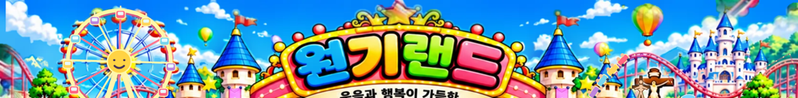
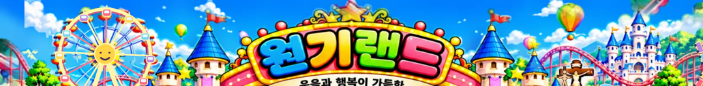
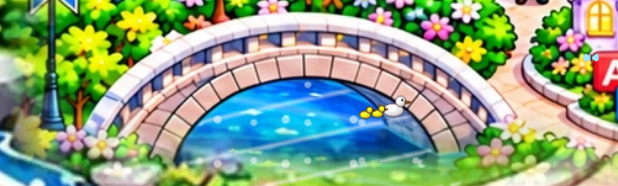

# 원기랜드 128차 — 그림 속 구름이 흐르고, 다리 밑 연못 물과 오리도 움직여요

## 올리는 방법

1. **새 그림 2개 → `작업장` 폴더**: `633cd260373929.webp`, `ee113e6cbe8f4e.webp` (하늘 바탕·구름 조각)
2. **HTML → `드래곤볼 수학게임` 폴더**: **[웰컴투 원기랜드.html](https://github.com/changdkand3-pixel/-/raw/claude/adoring-darwin-mewhr1/wonkiland-v128/%EC%9B%B0%EC%BB%B4%ED%88%AC%20%EC%9B%90%EA%B8%B0%EB%9E%9C%EB%93%9C.html)** 을 이름 그대로 덮어 올립니다.

전체: [wonkiland_v128_neocities.zip](https://github.com/changdkand3-pixel/-/raw/claude/adoring-darwin-mewhr1/wonkiland-v128/wonkiland_v128_neocities.zip). **서버 코드:** 바꿀 것 없음

## 바뀐 점 (127차 → 128차)

1. **☁️ 원래 그림의 구름이 흘러갑니다**
   - 지도 맨 위 하늘에 그려져 있던 구름 9조각을 그림에서 떼어 냈습니다. 원래 자리는 같은 하늘색으로 메웠습니다.
   - 구름은 천천히 오른쪽으로 흘러갑니다.
   - 하늘 모양으로만 보이게 해서, 관람차·성·깃발·간판 뒤로 지나가고 앞을 가리지 않습니다.
   - 관람차·성과 겹쳐 그려진 구름 두 덩이는 떼어 내면 모양이 깨져서 그대로 두었습니다.
2. **💧 다리 밑 연못**(왼쪽 모임코스 아래, 오른쪽 파이터즈 아래)
   - 물 모양 안에서만 물결 줄무늬 두 겹이 반대 방향으로 흐릅니다.
   - 물 위에 반짝임이 일렁입니다.
3. **🦆 오리**: 두 연못에도 오리 가족이 헤엄칩니다(왼쪽 3마리, 오른쪽 2마리).
4. **🎡 놀이공원 움직임 끄기**로 구름·연못도 같이 멈춥니다. 128차 업데이트 안내 카드도 넣었습니다.

**이번에 새로 생긴 그림 파일 (작업장에 올릴 것, 2개):**
- `633cd260373929.webp`
- `ee113e6cbe8f4e.webp`
