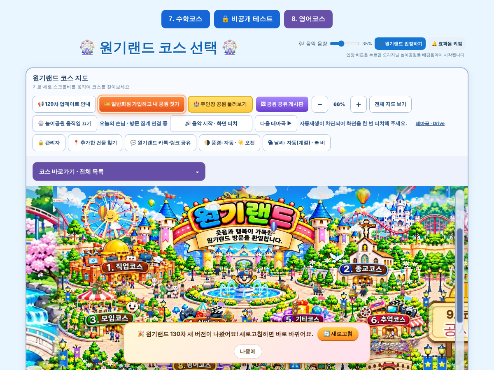

# 원기랜드 129차 — 새 버전이 나오면 보던 화면에 알려 줘요

## 올리는 방법

**HTML 하나만 올리면 됩니다(새 그림 없음).**
- **[웰컴투 원기랜드.html](https://github.com/changdkand3-pixel/-/raw/claude/adoring-darwin-mewhr1/wonkiland-v129/%EC%9B%B0%EC%BB%B4%ED%88%AC%20%EC%9B%90%EA%B8%B0%EB%9E%9C%EB%93%9C.html)** → `드래곤볼 수학게임` 폴더에 **지우지 말고 같은 이름으로 덮어** 올리기.

전체: [wonkiland_v129_neocities.zip](https://github.com/changdkand3-pixel/-/raw/claude/adoring-darwin-mewhr1/wonkiland-v129/wonkiland_v129_neocities.zip). **서버 코드:** 바꿀 것 없음

## 바뀐 점 (128차 → 129차)

1. **새 버전 알림**
   - 원기랜드를 열어 둔 화면이 5분마다, 그리고 다른 탭에 갔다가 돌아올 때 네오시티에 올라와 있는 HTML의 차수를 확인합니다.
   - 처음 확인은 연 뒤 1분 30초에 합니다.
   - 지금 보는 것보다 새 차수가 올라와 있으면 화면 아래에 안내가 뜹니다: **"🎉 원기랜드 NNN차 새 버전이 나왔어요! 새로고침하면 바로 바뀌어요."**
   - **🔄 새로고침**: 새 버전으로 바뀝니다. 네오시티가 예전 화면을 잠깐 기억하고 있어도 주소를 살짝 바꿔 한 번 더 불러옵니다.
   - **나중에**: 30분 동안 다시 안 뜹니다. 그 사이 또 새 차수가 올라오면 다시 뜹니다.
   - 저절로 새로고침하지 않아서, 하던 게임·글쓰기가 끊기지 않습니다.
2. **가볍게 확인**: 12MB짜리 HTML 전체를 받지 않고, 맨 앞부분(차수가 적힌 줄)만 읽고 끊습니다.
3. HTML 맨 위에 `<meta name="wonki-version" content="129">`가 들어갑니다. 차수는 업데이트 카드 번호를 따라 저절로 적힙니다.
4. 129차 업데이트 안내 카드.

> 이 알림은 **129차를 연 화면부터** 동작합니다. 그래서 130차를 올릴 때부터 안내가 뜹니다.

