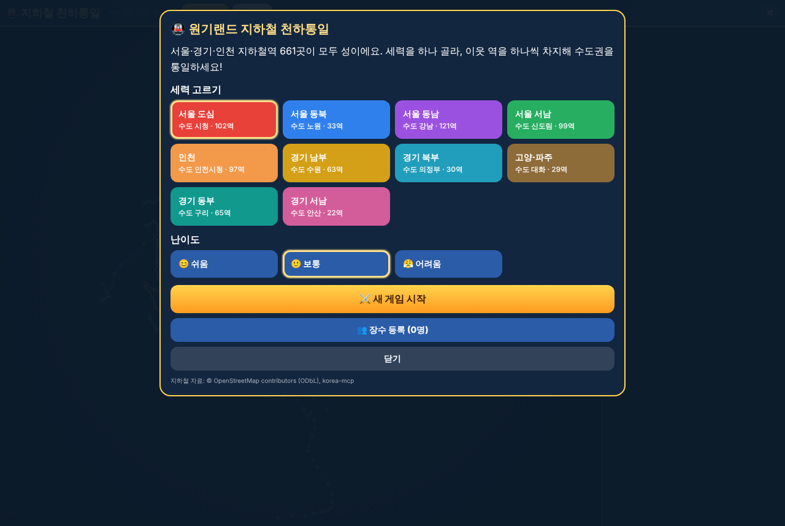
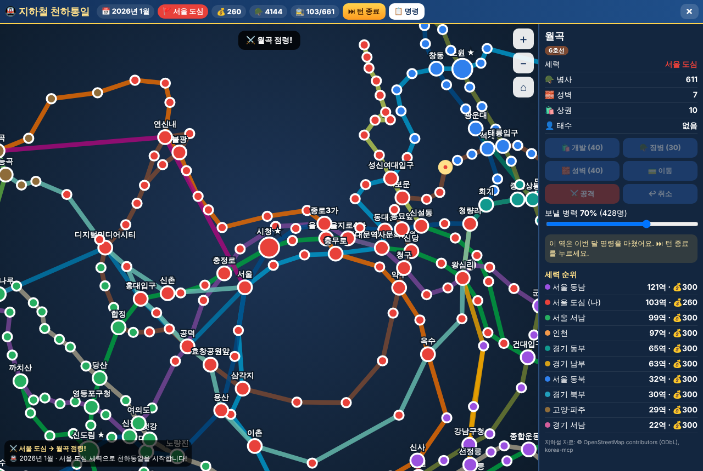
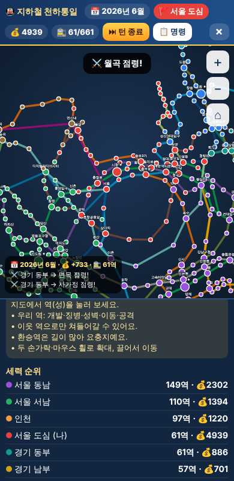
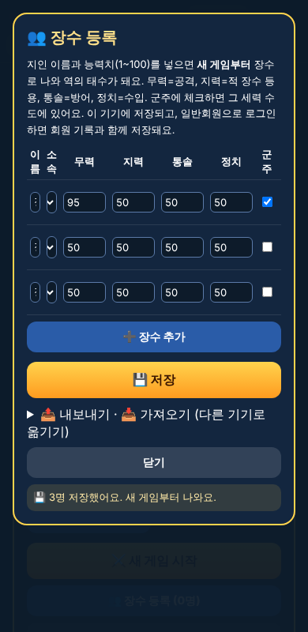

# 원기랜드 130차 — 🚇 원기랜드 지하철 천하통일 (1단계)

## 올리는 방법

**HTML 하나만 올리면 됩니다(새 그림 없음).**
- **[웰컴투 원기랜드.html](https://github.com/changdkand3-pixel/-/raw/claude/adoring-darwin-mewhr1/wonkiland-v130/%EC%9B%B0%EC%BB%B4%ED%88%AC%20%EC%9B%90%EA%B8%B0%EB%9E%9C%EB%93%9C.html)** → `드래곤볼 수학게임` 폴더에 지우지 말고 같은 이름으로 덮어 올리기.

전체: [wonkiland_v130_neocities.zip](https://github.com/changdkand3-pixel/-/raw/claude/adoring-darwin-mewhr1/wonkiland-v130/wonkiland_v130_neocities.zip). **서버 코드:** 바꿀 것 없음

## 바뀐 점 (129차 → 130차)

메인 지도 오른쪽(2·6번 코스 사이)에 **🚇 지하철 천하통일** 건물이 생겼습니다. 누르면 전체 화면으로 게임이 열립니다.

**지도**
- 서울·경기·인천 지하철 **661역**이 모두 성입니다. 1~9호선, 공항철도, 경의·중앙, 경춘, 수인·분당, 신분당, 경강, 서해, GTX-A, 인천 1·2, 우이신설, 신림, 김포골드, 용인·의정부 경전철, 자기부상 등 25개 노선이 들어 있습니다.
- 노선도는 실제 위치를 바탕으로 새로 그렸습니다. 서울 쪽은 넓게 펼쳐 보이게 했습니다.
- 확대·이동은 마우스 휠·끌기, 휴대폰은 두 손가락으로 합니다. 확대할수록 역 이름이 더 많이 보입니다.

**세력 10개**
- 서울 도심(수도 시청), 서울 동북(노원), 서울 동남(강남), 서울 서남(신도림), 인천(인천시청), 경기 남부(수원), 경기 북부(의정부), 고양·파주(대화), 경기 동부(구리), 경기 서남(안산)
- 역은 수도에서 가까운 세력으로 나눴습니다.
- 시작할 때 세력과 난이도(쉬움·보통·어려움)를 고릅니다.

**한 달(턴)마다 할 수 있는 것**
- 우리 역마다 한 가지 명령을 내립니다.
  - 🛍️ 개발(금 40): 상권이 올라 수입이 늘어요.
  - 🪖 징병(금 30)
  - 🧱 성벽(금 40)
  - 🚃 이동: 이웃한 우리 역으로 병력을 옮겨요.
  - ⚔️ 공격: 노선으로 이어진 이웃 적 역만 칠 수 있어요.
- 보낼 병력은 10~100%로 정합니다.
- 📋 명령 메뉴에서 한꺼번에 하기: 후방 병력을 전선으로 모으기, 모든 역 징병, 모든 역 개발
- 환승역은 금과 병사가 더 많이 나오는 요충지입니다.
- 가끔 이벤트가 생깁니다(출퇴근 혼잡 병사 +60, 상권 호황).
- 컴퓨터 세력도 개발·징병·공격·병력 이동을 하며, 서로 싸우기도 합니다.
- 모든 역을 차지하면 천하통일입니다.

**👥 장수 등록(지인 이름)**
- 시작 화면이나 📋 명령 → 장수 등록에서 이름, 소속 세력(또는 무작위), 무력·지력·통솔·정치(1~100, 🎲 무작위), 군주 여부를 넣습니다.
- 등록한 장수는 **새 게임부터** 역의 태수로 배치됩니다. 군주는 그 세력 수도에 있습니다.
- 능력치 효과: 무력=공격, 통솔=방어, 정치=그 역 수입, 지력=이긴 뒤 적 장수를 데려오는 확률
- 장수가 있는 역에서 병력을 절반 넘게 보내면 장수도 함께 갑니다.
- 역을 빼앗기면 그 역의 장수는 적에게 합류하거나, 후퇴하거나, 재야로 떠납니다.
- 📤 내보내기 · 📥 가져오기로 다른 기기에 옮길 수 있습니다.

**저장**
- 게임과 장수 목록은 이 기기에 자동 저장됩니다.
- 일반회원으로 로그인하면 회원 기록과 함께 저장되어 다른 기기에서도 이어집니다(`wk130_generals`, `wk130_save`).

지하철 자료: © OpenStreetMap contributors (ODbL), korea-mcp 패키지(MIT). 서울교통공사 노선도 그림은 쓰지 않았습니다. 130차 업데이트 안내 카드도 넣었습니다.

