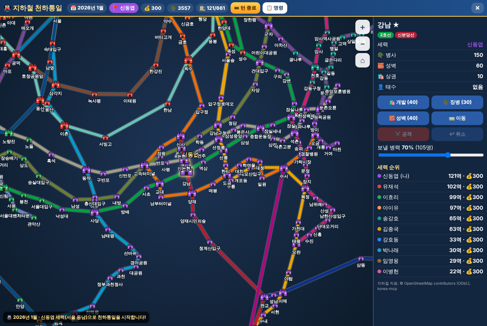
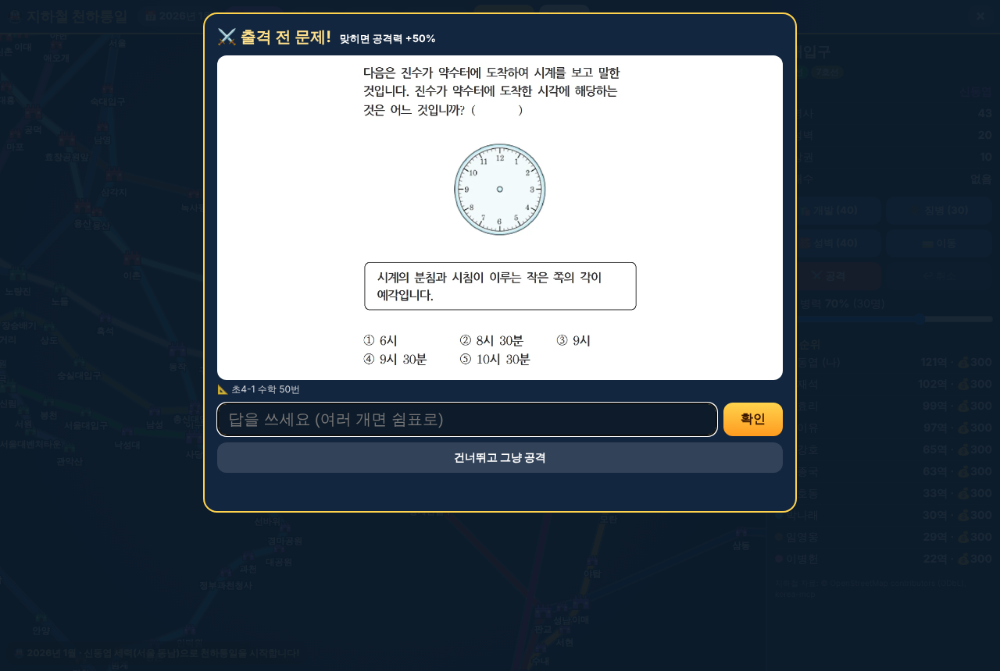

# 원기랜드 131차 — 지하철 천하통일: 자리 옮김 · 수학·영어 문제 전투 · 모든 역 이름 · 연예인 세력

## 올리는 방법

**HTML 하나만 올리면 됩니다(새 그림 없음).**
- **[웰컴투 원기랜드.html](https://github.com/changdkand3-pixel/-/raw/claude/adoring-darwin-mewhr1/wonkiland-v131/%EC%9B%B0%EC%BB%B4%ED%88%AC%20%EC%9B%90%EA%B8%B0%EB%9E%9C%EB%93%9C.html)** → `드래곤볼 수학게임` 폴더에 지우지 말고 같은 이름으로 덮어 올리기.

전체: [wonkiland_v131_neocities.zip](https://github.com/changdkand3-pixel/-/raw/claude/adoring-darwin-mewhr1/wonkiland-v131/wonkiland_v131_neocities.zip). **서버 코드:** 바꿀 것 없음

## 바뀐 점 (130차 → 131차)

1. **건물 자리**: 메인 지도 왼쪽, **1. 직업코스와 3. 모임코스 사이**로 옮겼습니다. 코스 누르는 칸과 겹치지 않습니다.
2. **📚 수학·영어 문제 전투**
   - 공격할 역을 누르면 출격 전에 문제가 나옵니다. **맞히면 공격력 +50%**, 틀리면 정답을 보여 주고 그냥 공격합니다. "건너뛰고 그냥 공격"도 있습니다.
   - 수학: 원기랜드 수학 게임의 원본 문제 그림(초1-1~초5-2 중 고른 학년)을 그대로 씁니다. 답을 쓰고, 여러 개면 쉼표로 씁니다. ①~⑤는 숫자로 써도 됩니다.
   - 영어: 영어 단어 뜻 4지선다(초등·중등·고등 단어)입니다.
   - 시작 화면에서 수학+영어 / 수학만 / 영어만 / 끄기, 수학 학년, 영어 수준을 고릅니다.
3. **지도 자세히**
   - 지도를 1.6배 크게 그렸습니다.
   - 661역마다 세력 색깔의 **성 그림**을 넣었습니다. 환승역은 큰 성, 수도는 깃발 달린 큰 성입니다.
   - **모든 역 이름이 항상** 보이고, 확대하면 글자도 커집니다.
   - 노선은 흰 테두리가 있는 굵은 선이고, 수도 위에 세력 이름이 크게 보입니다.
   - 처음에는 우리 수도를 크게 보여 줍니다.
4. **세력 이름 = 연예인 이름**(시작 화면 ✏️ 세력 이름 바꾸기에서 바꿀 수 있음):

   | 세력 이름 | 지역 |
   |---|---|
   | 유재석 | 서울 도심 |
   | 강호동 | 서울 동북 |
   | 신동엽 | 서울 동남 |
   | 이효리 | 서울 서남 |
   | 아이유 | 인천 |
   | 김종국 | 경기 남부 |
   | 박나래 | 경기 북부 |
   | 임영웅 | 고양·파주 |
   | 송강호 | 경기 동부 |
   | 이병헌 | 경기 서남 |

5. 131차 업데이트 안내 카드.

