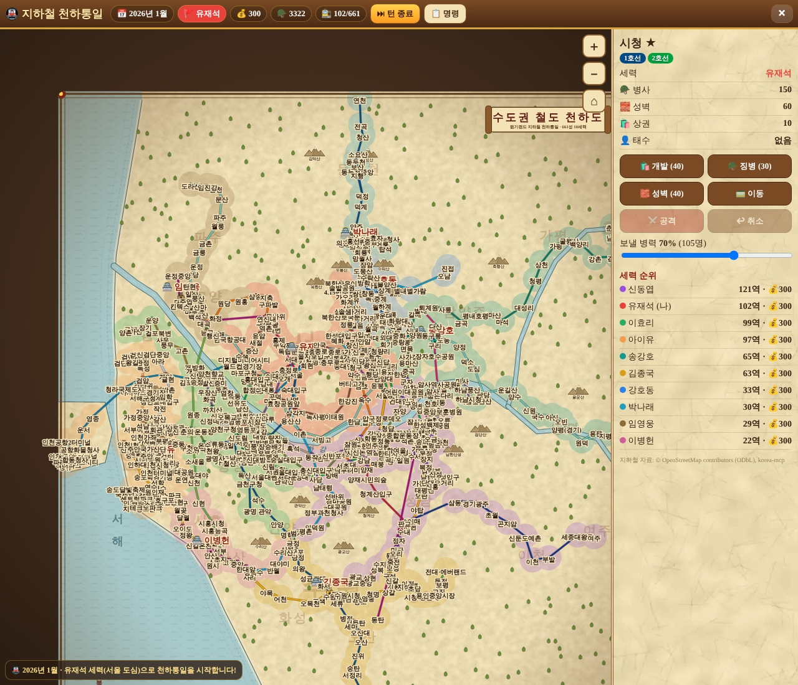
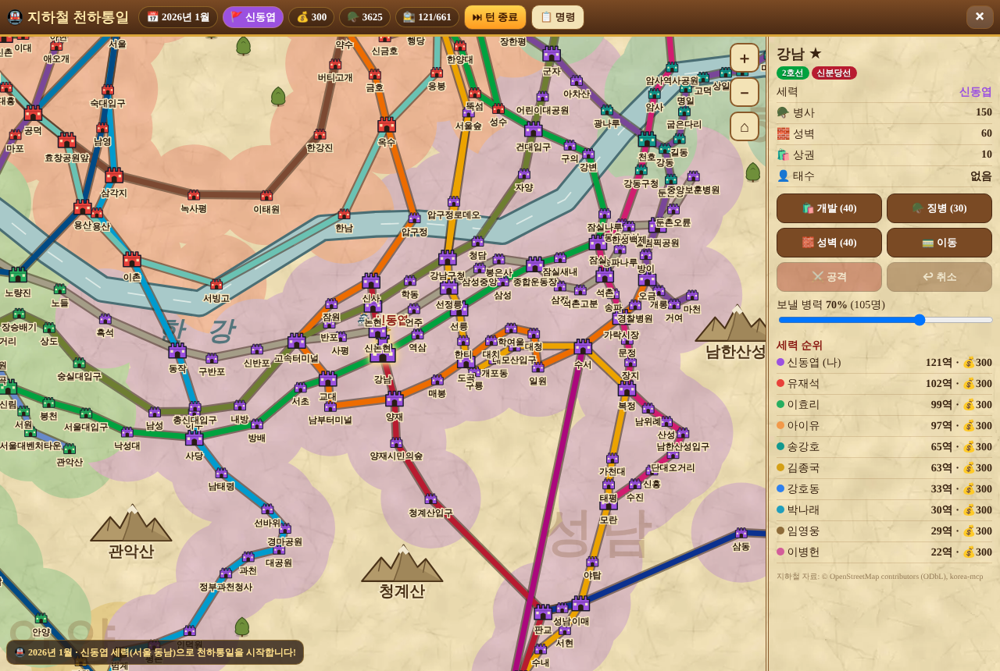
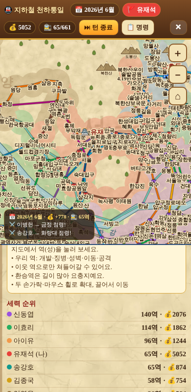

# 원기랜드 132차 — 지하철 천하통일 지도를 옛 지도(천하도)처럼

## 올리는 방법

1. **새 그림 1개 → `작업장` 폴더**: `58dc6d37d02d18.webp` (한지 무늬)
2. **HTML → `드래곤볼 수학게임` 폴더**: **[웰컴투 원기랜드.html](https://github.com/changdkand3-pixel/-/raw/claude/adoring-darwin-mewhr1/wonkiland-v132/%EC%9B%B0%EC%BB%B4%ED%88%AC%20%EC%9B%90%EA%B8%B0%EB%9E%9C%EB%93%9C.html)** 지우지 말고 같은 이름으로 덮어 올리기.

전체: [wonkiland_v132_neocities.zip](https://github.com/changdkand3-pixel/-/raw/claude/adoring-darwin-mewhr1/wonkiland-v132/wonkiland_v132_neocities.zip). **서버 코드:** 바꿀 것 없음

## 바뀐 점 (131차 → 132차)

지하철 천하통일 지도를 전략 게임 옛 지도처럼 꾸몄습니다. 모두 새로 그렸고, 코에이 게임 그림은 쓰지 않았습니다.

**지도 위 꾸밈**
- **📜 한지 바탕**: 결이 보이는 누런 종이, 가장자리가 어두워지는 빛바램
- **🌊 바다**: 서해 바다에 물결 무늬, 해안선, 겹쳐 그린 파도 점선, 영종도. 세로로 「서 해」 글씨
- **〰️ 강**: 한강·북한강·남한강이 흐르고 「한 강」 글씨
- **⛰️ 산 15곳**: 북한산·도봉산·수락산·불암산·관악산·청계산·남한산성·광교산·계양산·소요산·감악산·용문산·축령산·수리산·검단산(눈 덮인 봉우리 그림·이름)
- **🌳 숲**: 빈 땅에 나무 320그루
- **🏯 고을 이름**: 서울·인천·수원 크게, 성남·고양·의정부 등 23곳을 옅게 크게
- **세력 땅 색**: 역 주변 땅이 그 세력 색으로 물들어 영역이 한눈에 보입니다. 점령하면 바뀝니다.
- **📜 제목 두루마리** 「수도권 철도 천하도」, **🧭 나침반**(동서남북), 두 겹 테두리와 모서리 장식

**글자와 화면**
- 역 이름은 갈색 붓글씨 느낌 글자에 흰 테두리, 수도 위 세력 이름은 붉은 글자로 바꿨습니다.
- 노선은 짙은 갈색 테두리를 둘렀습니다.
- 게임 화면도 나무·한지 색으로 바꿨습니다(위 막대, 오른쪽 정보 칸, 시작·장수·문제 창).

132차 업데이트 안내 카드도 넣었습니다.

**이번에 새로 생긴 그림 파일 (작업장에 올릴 것, 1개):**
- `58dc6d37d02d18.webp`
