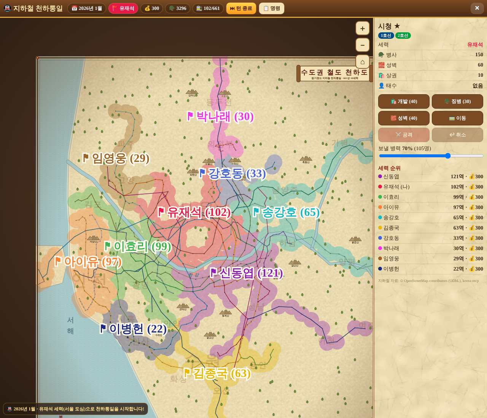
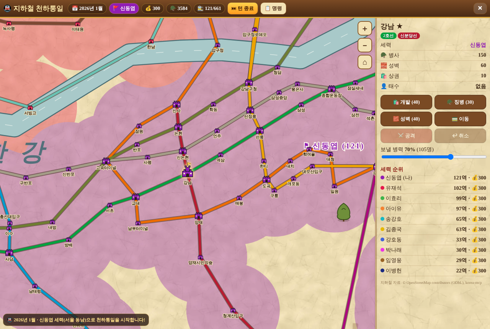

# 원기랜드 133차 — 천하도를 더 크게(역 이름 겹침 없음) · 세력 색 또렷하게

## 올리는 방법

**HTML 하나만 올리면 됩니다(새 그림 없음).**
- **[웰컴투 원기랜드.html](https://github.com/changdkand3-pixel/-/raw/claude/adoring-darwin-mewhr1/wonkiland-v133/%EC%9B%B0%EC%BB%B4%ED%88%AC%20%EC%9B%90%EA%B8%B0%EB%9E%9C%EB%93%9C.html)** → `드래곤볼 수학게임` 폴더에 지우지 말고 같은 이름으로 덮어 올리기.
- 132차 새 그림 `58dc6d37d02d18.webp`를 아직 안 올리셨다면 `작업장` 폴더에 먼저 올려 주세요.

전체: [wonkiland_v133_neocities.zip](https://github.com/changdkand3-pixel/-/raw/claude/adoring-darwin-mewhr1/wonkiland-v133/wonkiland_v133_neocities.zip). **서버 코드:** 바꿀 것 없음

## 바뀐 점 (132차 → 133차)

1. **지도 크게**
   - 지도 넓이를 3200 → 7200으로 키웠습니다. 산·숲·글씨·나침반도 같은 비율로 커졌습니다.
   - 역 이름 자리를 역마다 12방향 중 빈 곳으로 미리 정해서, **661개 이름이 서로 겹치지 않습니다**(겹침 0개 확인).
   - 이름 글자는 지도에 붙어 있어서, 확대할수록 커집니다.
   - 아주 멀리 축소하면 이름은 잠시 숨고, 세력 이름만 보입니다.
2. **세력 색**
   - 10세력을 서로 확실히 다른 색으로 바꿨습니다: 빨강·파랑·보라·초록·주황·노랑·분홍·갈색·하늘색·남색.
   - 땅 색도 더 진하게 했습니다.
   - 각 세력 땅 가운데에 **⚑ 세력 이름(역 수)**을 그 세력 색 큰 글씨로 띄웁니다. 점령하면 자리와 숫자가 바뀝니다.
3. 133차 업데이트 안내 카드.

