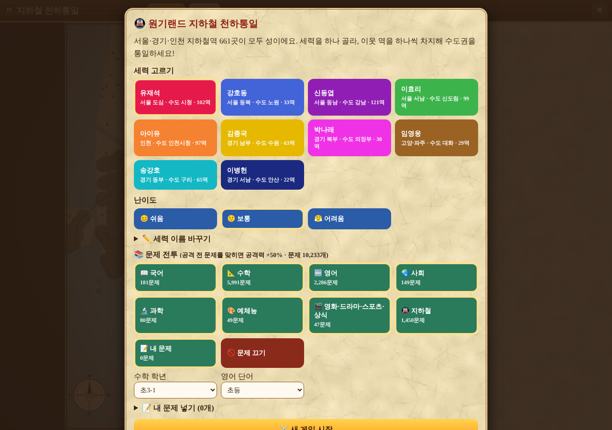
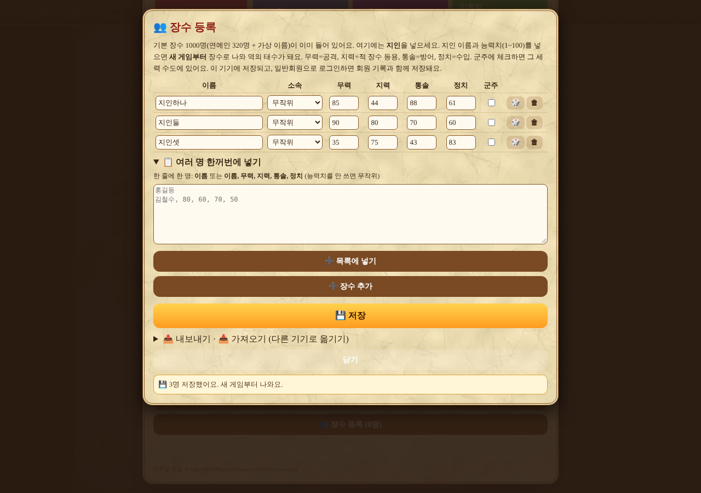
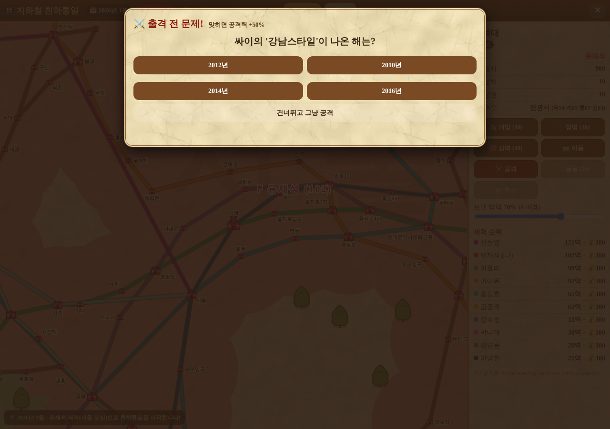
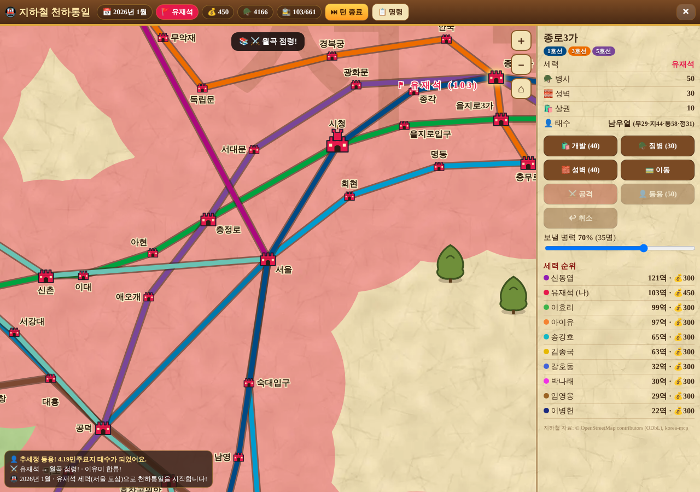

# 원기랜드 134차 — 지하철 천하통일: 장수 1000명 · 문제 1만 개 · 노선도처럼 나란히

## 올리는 방법

**HTML 하나만 올리면 됩니다(새 그림 없음).**
- **[웰컴투 원기랜드.html](https://github.com/changdkand3-pixel/-/raw/claude/adoring-darwin-mewhr1/wonkiland-v134/%EC%9B%B0%EC%BB%B4%ED%88%AC%20%EC%9B%90%EA%B8%B0%EB%9E%9C%EB%93%9C.html)** → `드래곤볼 수학게임` 폴더에 지우지 말고 같은 이름으로 덮어 올리기.

전체: [wonkiland_v134_neocities.zip](https://github.com/changdkand3-pixel/-/raw/claude/adoring-darwin-mewhr1/wonkiland-v134/wonkiland_v134_neocities.zip). **서버 코드:** 바꿀 것 없음

## 바뀐 점 (133차 → 134차)

**👥 장수 1000명 + 지인**
- 기본 장수 1000명이 들어 있습니다. 연예인 320명과 가상 이름 680명이고, 능력치는 무작위입니다.
- 새 게임마다 섞어서 역의 약 70%에 태수로 앉히고, 나머지는 재야로 둡니다.
- 각 세력의 군주는 세력 이름과 같은 장수(유재석 등)로, 수도에 있습니다.
- **👤 등용(금 50)**: 태수가 없는 우리 역에서 재야 장수를 데려옵니다. 컴퓨터 세력도 등용합니다.
- 장수 등록 창에 **📋 여러 명 한꺼번에 넣기**가 생겼습니다.
  - 한 줄에 한 명씩 `이름` 또는 `이름, 무력, 지력, 통솔, 정치`로 씁니다.
  - 지인 장수는 기본 장수보다 먼저 배치됩니다.

**📚 문제 10,233개 (9과목)**
| 과목 | 문제 수 | 내용 |
|---|---|---|
| 📖 국어 | 181 | 속담 빈칸, 사자성어 뜻(양방향), 맞춤법 |
| 📐 수학 | 5,991 | 원본 문제 그림 991 + 학년에 맞춘 계산 |
| 🔤 영어 | 2,286 | 단어 뜻 ↔ 영어 (초·중·고 1143단어) |
| 🌏 사회 | 149 | 나라와 수도(양방향), 역사·지리·생활 |
| 🔬 과학 | 80 | 원소 기호(양방향), 생물·지구·물질 |
| 🎨 예체능 | 49 | 악기 종류, 화가·작곡가, 색 섞기, 음표, 운동 경기 인원 |
| 🎬 영화·드라마·스포츠·상식 | 47 | 직접 확인한 상식 문제 |
| 🚇 지하철 | 1,450 | 역의 노선, 바로 이어진 역 |
| 📝 내 문제 | 직접 입력 | 주인장이 넣은 문제 |

- 시작 화면에서 과목을 골라 켜고 끕니다. 대부분 4지선다이고, 수학과 답을 직접 쓰는 내 문제는 답을 씁니다.
- **📝 내 문제 넣기**: 한 줄에 `문제 | 정답 | 오답 | 오답 | 오답`처럼 씁니다. 오답을 안 쓰면 답을 직접 쓰는 문제가 됩니다.
- 과목마다 300문제씩 자동으로 만들어 보고, 정답이 보기에 있는지와 보기가 겹치지 않는지 확인했습니다.

**🚇 노선도처럼**
- 같은 구간을 여러 노선이 지날 때 지하철 노선도처럼 **나란히** 그립니다.
- 역 이름은 다른 이름·역뿐 아니라 **노선 선도 피해서** 자리를 정했습니다(이름 겹침 0개).

134차 업데이트 안내 카드도 넣었습니다.

