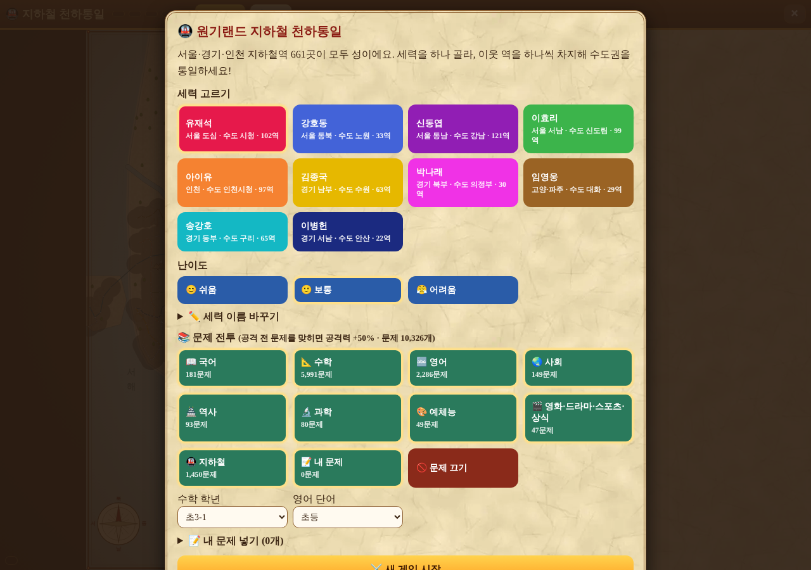

# 원기랜드 135차 — 천하통일: 연예인 장수 575명 · 역사 문제 · 주인장 전용

## 올리는 방법

**HTML 하나만 올리면 됩니다(새 그림 없음).**
- **[웰컴투 원기랜드.html](https://github.com/changdkand3-pixel/-/raw/claude/adoring-darwin-mewhr1/wonkiland-v135/%EC%9B%B0%EC%BB%B4%ED%88%AC%20%EC%9B%90%EA%B8%B0%EB%9E%9C%EB%93%9C.html)** → `드래곤볼 수학게임` 폴더에 지우지 말고 같은 이름으로 덮어 올리기.

전체: [wonkiland_v135_neocities.zip](https://github.com/changdkand3-pixel/-/raw/claude/adoring-darwin-mewhr1/wonkiland-v135/wonkiland_v135_neocities.zip). **서버 코드:** 바꿀 것 없음

## 바뀐 점 (134차 → 135차)

1. **주인장 전용**: 지하철 천하통일 건물은 **주인장 기기**(관리자로 로그인했던 기기)에서만 보입니다. 다른 방문객·회원에게는 건물이 없습니다.
   - 130~135차 업데이트 카드도 방문객에게는 보이지 않게 했습니다(관리자 전용 차수).
2. **연예인 장수 320명 → 575명**: 배우·예능인·가수·아이돌을 더 넣었습니다.
   - 기본 장수는 모두 1000명이고, 나머지 425명은 가상 이름입니다.
3. **🏯 역사 문제 93개**: 한국사 68(고조선~현대, 지폐 인물 포함)과 세계사 25입니다. 시작 화면에서 과목으로 켜고 끕니다.
4. **지인 많이 넣기**: 장수 목록 가져오기 한도를 200명에서 5000명으로 늘렸습니다.
   - 📋 여러 명 한꺼번에 넣기에 엑셀에서 복사한 표(이름 / 무력 / 지력 / 통솔 / 정치, 탭으로 나뉜 칸)를 그대로 붙여 넣어도 됩니다.
5. 135차 업데이트 안내 카드.

