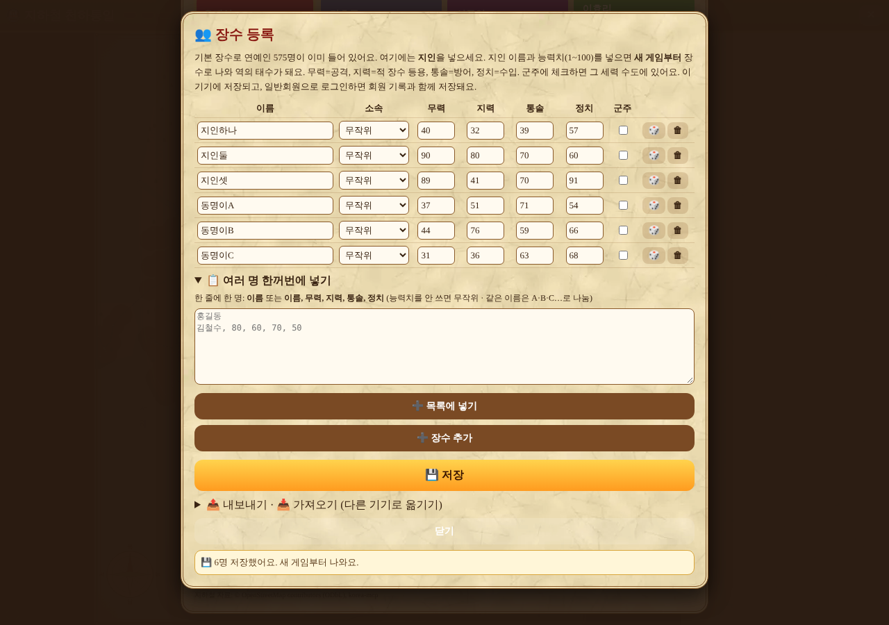

# 원기랜드 137차 — 천하통일 지인 장수 동명이인 A·B·C

## 올리는 방법

**HTML 하나만 올리면 됩니다(새 그림 없음).**
- **[웰컴투 원기랜드.html](https://github.com/changdkand3-pixel/-/raw/claude/adoring-darwin-mewhr1/wonkiland-v137/%EC%9B%B0%EC%BB%B4%ED%88%AC%20%EC%9B%90%EA%B8%B0%EB%9E%9C%EB%93%9C.html)** → `드래곤볼 수학게임` 폴더에 지우지 말고 같은 이름으로 덮어 올리기.

전체: [wonkiland_v137_neocities.zip](https://github.com/changdkand3-pixel/-/raw/claude/adoring-darwin-mewhr1/wonkiland-v137/wonkiland_v137_neocities.zip). **서버 코드:** 바꿀 것 없음

## 바뀐 점 (136차 → 137차)

1. 장수 등록 → 📋 여러 명 한꺼번에 넣기에서 **같은 이름이 여러 번 나오면 이름 뒤에 A·B·C…**를 붙입니다(예: 홍길동A, 홍길동B).
   - 목록에 이미 같은 이름이 있으면, 원래 있던 사람이 A가 되고 새로 넣은 사람이 B가 됩니다.
   - 26명을 넘으면 AA, AB…로 이어집니다.
2. 137차 업데이트 안내 카드(관리자 전용 차수).

