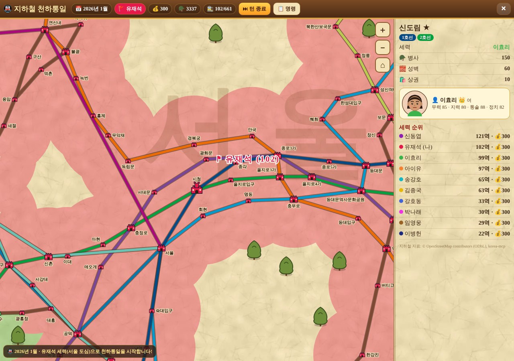

# 원기랜드 138차 — 천하통일 장수 얼굴 그림 · 성별 · 많은 지인 한 번에 넣기

## 올리는 방법

**HTML 하나만 올리면 됩니다(새 그림 없음).**
- **[웰컴투 원기랜드.html](https://github.com/changdkand3-pixel/-/raw/claude/adoring-darwin-mewhr1/wonkiland-v138/%EC%9B%B0%EC%BB%B4%ED%88%AC%20%EC%9B%90%EA%B8%B0%EB%9E%9C%EB%93%9C.html)** → `드래곤볼 수학게임` 폴더에 지우지 말고 같은 이름으로 덮어 올리기.

전체: [wonkiland_v138_neocities.zip](https://github.com/changdkand3-pixel/-/raw/claude/adoring-darwin-mewhr1/wonkiland-v138/wonkiland_v138_neocities.zip). **서버 코드:** 바꿀 것 없음

## 바뀐 점 (137차 → 138차)

1. **👤 장수 얼굴**
   - 장수마다 얼굴 그림이 생겼습니다. 역을 누르면 오른쪽 칸에 태수 얼굴·이름·능력치가 나옵니다.
   - 실제 사진이나 닮은 그림이 아니라, 이름에 따라 정해지는 새로 그린 얼굴입니다. 피부·머리 모양·머리색·눈·입·안경·옷 색이 사람마다 다르고, 같은 이름이면 늘 같은 얼굴입니다.
   - 성별에 따라 머리 모양이 다릅니다.
2. **성별**
   - 장수 등록 표에 성별 칸(남·여·?)이 생겼습니다.
   - 연예인 571명은 성별을 넣어 두었습니다. 그룹 이름 4개(멜로망스·십센치·볼빨간사춘기·악뮤)는 사람이 아니라서 뺐습니다.
   - 붙여넣기는 `이름` / `이름, 남` / `이름, 여, 무력, 지력, 통솔, 정치` 모두 됩니다.
3. **많은 지인 한 번에**
   - 2,345명을 붙여 넣어도 약 3초 안에 들어가도록 고쳤습니다.
   - 동명이인은 전체 목록 순서대로 A·B·C를 붙입니다.
   - 표에서 얼굴은 앞 300명까지만 그려서 느려지지 않게 했습니다.
4. 138차 업데이트 안내 카드(관리자 전용 차수).

> 지인이 2천 명이 넘으면 지인이 먼저 역의 태수가 되어서, 연예인은 대부분 재야(👤 등용)로 갑니다.

