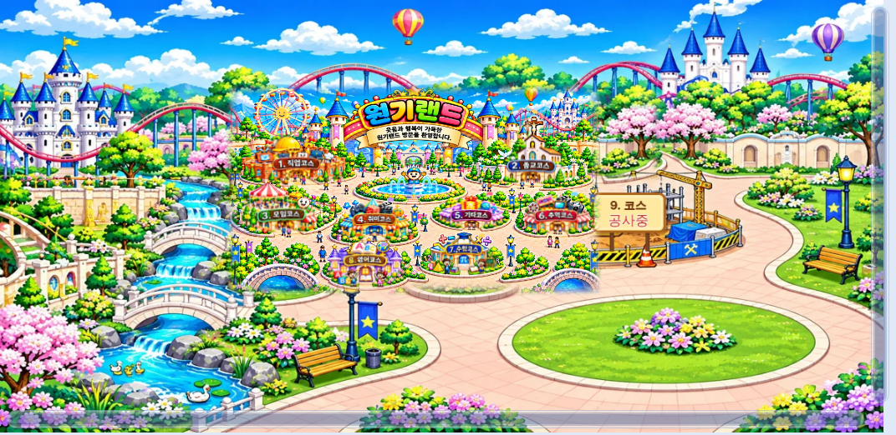
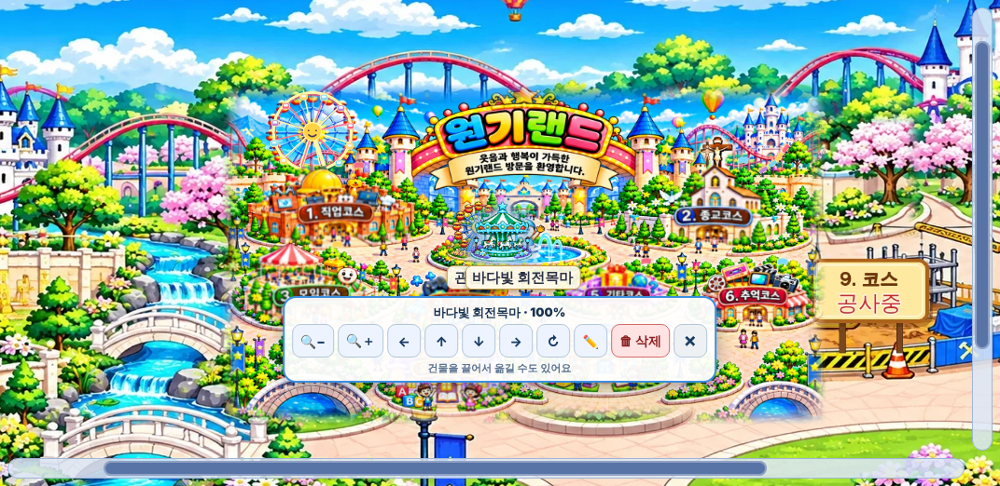

# 원기랜드 50차

## ⬇️ 다운로드

### **[👉 wonkiland_v50.html 바로 받기 (약 27MB)](https://github.com/changdkand3-pixel/-/raw/claude/adoring-darwin-mewhr1/wonkiland-v50/wonkiland_v50.html)**

링크를 누르면 파일이 바로 내려받아집니다. 브라우저에 글자가 가득한 화면이 나오면 그 화면에서 **마우스 오른쪽 버튼 → 다른 이름으로 저장**(휴대폰은 공유 → 파일에 저장)을 눌러 `wonkiland_v50.html`로 저장하세요. 압축을 풀거나 파일을 합칠 필요는 없습니다. 그림과 음악이 모두 들어 있습니다.

받은 파일을 Neocities에 올리면 됩니다. 49차 파일을 바탕으로 아래만 바꿨습니다.

## 바뀐 점

1. **건물을 설치하면 바로 지도에 보입니다.**
   - 처음 "건물 추가"를 누르면 오류가 나던 문제를 고쳤습니다. (기본 건물 종류가 목록에 없는 값이었습니다.)
   - 건물이 지도와 다른 위치에 그려지던 문제를 고쳤습니다.
   - 건물 짓기 창을 닫으면 메인 지도가 새 건물 쪽으로 이동합니다.
2. **메인 지도에서 건물을 누르면 바로 편집 도구가 열립니다.** (편집 모드 버튼 필요 없음)
   - 🔍− 축소 · 🔍＋ 확대 · ← ↑ ↓ → 이동 · ↻ 회전 · ✏️ 이름 · 🗑 삭제
   - 건물을 끌어서 옮길 수도 있습니다. 삭제한 뒤 7초 안에 "되돌리기"를 누르면 복구됩니다.
   - 빈 곳을 누르거나 ✕ 또는 Esc로 닫습니다. 두 번 누르면 연결된 코스가 열립니다.
3. **메인 화면으로 돌아와도 지도가 갑자기 확대되지 않고, 노란 테두리가 나오지 않습니다.** (코스·건물·편집 창 모두)
4. **흐린 부분을 없앴습니다.** 원본 지도를 늘려 붙인 흐린 배경과, 확장 그림 가운데의 반투명 겹침 지도를 없앴습니다.
5. **건물 종류 1,000종**: 기본 그림 100종 × 색 테마 10종 (기본·노을빛·숲속·바다빛·보랏빛·장밋빛·황금빛·민트·밤하늘·파스텔). 검색창에서 "바다빛", "관람차"처럼 찾을 수 있습니다. 49차까지 저장한 건물은 그대로 보입니다.
6. **확장 지도를 다시 그렸습니다.** 선명한 원본 지도를 확장 공원 그림 가운데에 부드러운 경계로 합쳤습니다. 경계에 걸쳐 잘려 보이던 "6.추억코스" 간판을 나무로 덮고, "9. 코스 공사중" 간판을 새로 그려 공사장 옆에 붙였습니다. 9코스 바로가기도 그 공사장으로 이동합니다.
7. **방명록 버튼을 방문자 수 바로 옆에 고정했습니다.** 누르면 방명록이 그 아래에 열리고, 지도 위에 떠 있지 않습니다. 버튼에 글 수가 표시됩니다.

8. **포스터형 50차 업데이트 안내 카드**가 페이지를 열 때 가운데에 크게 나옵니다. 요청·문제 / 변경 사항 / 지금 상태 / 핵심 요약으로 나뉘어 있습니다. "확인"이나 ×로 닫고, "오늘 하루 보지 않기"를 고를 수 있습니다. 지도 도구의 "📢 50차 업데이트 안내" 버튼으로 다시 볼 수 있습니다. 예전 48·49차 작은 카드는 숨겼습니다.

## 확인한 것

PC(1280×900)와 휴대폰(iPhone 13 크기) Chromium에서 확인했습니다: 건물 추가 후 메인 지도 표시, 누르기·확대·이동·끌기·삭제·되돌리기, 새로고침 후 유지, 방명록 열기, 코스 메뉴 열기, 스크립트 60개 구문 오류 없음.

외부 서버(방문자 수·방명록 동기화·Drive 음악)는 이 시험 환경에서 연결하지 않았으므로 실제 Neocities에서 한 번 더 확인해 주세요.

