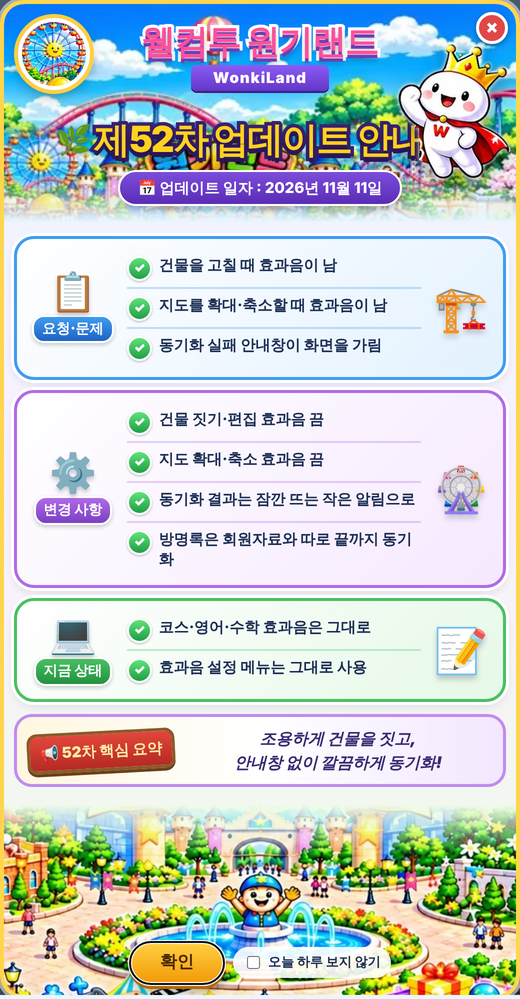

# 원기랜드 52차

## ⬇️ 다운로드

### **[👉 wonkiland_v52.html 바로 받기 (약 27MB)](https://github.com/changdkand3-pixel/-/raw/claude/adoring-darwin-mewhr1/wonkiland-v52/wonkiland_v52.html)**

링크를 누르면 파일이 내려받아집니다. 글자가 가득한 화면이 나오면 **마우스 오른쪽 버튼 → 다른 이름으로 저장**(휴대폰은 공유 → 파일에 저장)으로 `wonkiland_v52.html`을 저장하세요. 이 파일 한 개만 Neocities에 올리면 됩니다.

## 바뀐 점 (51차 → 52차)

1. **건물 효과음을 껐습니다.** 건물 짓기 화면에서 그림 누르기, 이동, 확대·축소, 크기 손잡이, 삭제, 저장 후 나가기를 할 때 소리가 나지 않습니다. 메인 지도의 건물 편집 도구와 지도 확대·축소 버튼도 소리가 나지 않습니다.
2. **전체 동기화 안내창을 없앴습니다.** 결과는 화면 아래에 작은 알림으로 6초 동안만 보입니다. 자세한 내용은 버튼에 마우스를 올리면 볼 수 있습니다.
3. 방명록 동기화 대기 시간을 25초에서 45초로 늘렸습니다.
4. 52차 업데이트 안내 카드가 나옵니다.

코스·랜덤·결과 전송·영어·수학 효과음과 효과음 설정 메뉴는 그대로입니다.

## 동기화 서버 상태 (2026년 11월 11일 확인)

동기화 서버(Google Apps Script)에 직접 요청해 보니 **서버 연결과 방명록은 1~2초 안에 정상 응답**했습니다. 하지만 **관리자 로그인이 필요한 회원자료 요청은 60~90초가 지나도 응답이 없었습니다.** 어제는 같은 요청이 바로 응답했으므로, 서버 쪽 로그인 확인 단계가 멈춰 있는 것으로 보입니다. 이 문제는 HTML이 아니라 Apps Script 쪽에서 확인해야 합니다. (Apps Script 편집기 → 실행 기록에서 오래 걸리거나 실패한 실행이 있는지 확인해 주세요.)

