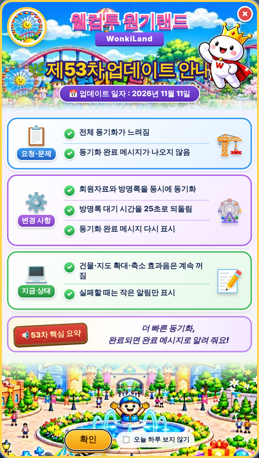

# 원기랜드 53차

## ⬇️ 다운로드

### **[👉 wonkiland_v53.html 바로 받기 (약 27MB)](https://github.com/changdkand3-pixel/-/raw/claude/adoring-darwin-mewhr1/wonkiland-v53/wonkiland_v53.html)**

링크를 누르면 파일이 내려받아집니다. 글자가 가득한 화면이 나오면 **마우스 오른쪽 버튼 → 다른 이름으로 저장**(휴대폰은 공유 → 파일에 저장)으로 `wonkiland_v53.html`을 저장하세요. 이 파일 한 개만 Neocities에 올리면 됩니다.

## 바뀐 점 (52차 → 53차)

1. **전체 동기화가 빨라졌습니다.** 회원자료와 방명록을 차례로 하지 않고 동시에 동기화합니다. 시험에서 각각 3초 걸리는 경우 전체 6초 → 3초로 줄었습니다.
2. **방명록 응답 대기 시간을 다시 25초로 되돌렸습니다.**
3. **동기화가 모두 끝나면 예전처럼 "전체 동기화가 완료되었습니다." 메시지가 나옵니다.**
4. 일부가 실패하면 큰 안내창 대신 화면 아래 작은 알림만 6초 동안 보입니다.
5. 53차 업데이트 안내 카드가 나옵니다.

건물·지도 확대·축소 효과음은 52차처럼 계속 꺼져 있습니다.

동기화 서버 확인(2026년 11월 11일): 회원자료 요청이 1.4초, 방명록 요청이 2초 만에 정상 응답했습니다. 52차 때 멈춰 있던 서버 응답이 다시 돌아왔습니다.

