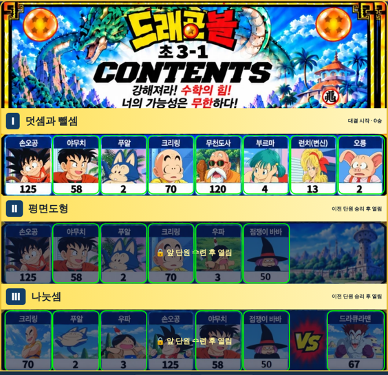

# 원기랜드 54차

## ⬇️ 다운로드

### **[👉 wonkiland_v54.html 바로 받기 (약 30MB)](https://github.com/changdkand3-pixel/-/raw/claude/adoring-darwin-mewhr1/wonkiland-v54/wonkiland_v54.html)**

링크를 누르면 파일이 내려받아집니다. 글자가 가득한 화면이 나오면 **마우스 오른쪽 버튼 → 다른 이름으로 저장**(휴대폰은 공유 → 파일에 저장)으로 `wonkiland_v54.html`을 저장하세요. 이 파일 한 개만 Neocities에 올리면 됩니다.

## 바뀐 점 (53차 → 54차)

1. **건물 ✕ 버튼을 정리했습니다.** 건물을 배치하거나 옮긴 뒤에는 ✕가 보이지 않습니다. 건물을 눌러 선택했을 때만 건물 오른쪽 위 바깥에 작게 나옵니다. (건물이 작을 때 ✕가 건물을 가리던 문제도 고쳤습니다.) 건물 짓기 화면에서도 새로 놓은 건물에는 ✕와 크기 손잡이가 없고, 건물을 눌러야 나타납니다.
2. **수학 초3-1을 열었습니다.** 구글 드라이브 `문제파일/초3-1.pdf`의 원본 100문항과 빠른 정답을 그대로 넣었습니다.
   - Ⅰ 덧셈과 뺄셈 33문항 · Ⅱ 평면도형 21문항 · Ⅲ 나눗셈 20문항 · Ⅳ 곱셈 10문항 · Ⅴ 길이와 시간 7문항 · Ⅵ 분수와 소수 9문항 (짧은 단원은 문제가 반복됩니다)
   - 답이 여러 개인 문제(43번, 67번)는 띄어쓰기나 쉼표로 여러 개를 입력합니다.
3. **영어 초3-1도 같은 목차 그림으로 대결합니다.** 핵심 어휘 = Ⅰ·Ⅱ, 문법·표현 = Ⅲ·Ⅳ, 독해·문맥 = Ⅴ·Ⅵ 줄의 캐릭터와 대결합니다. 영어 문제(151개 이상)는 그대로입니다.
4. **구글 드라이브 `3-1` 폴더의 그림을 적용했습니다.** `초3-1.jpg` 목차 그림과 캐릭터 그림으로 12명(손오공 125, 야무치 58, 푸알 2, 크리링 70, 무천도사 120, 부르마 4, 런치(변신) 13, 오룡 2, 우파 3, 점쟁이 바바 50, 드라큘라맨 67, 투명인간 40)을 만들었습니다.
5. 54차 업데이트 안내 카드가 나옵니다.

## 확인한 것

Chromium에서 확인했습니다: 수학 초3-1 목차 그림의 상대 38명 버튼 위치, 대결 시작·문제 그림 표시·정답 처리, 영어 초3-1 목차와 대결, 수학 초2-2 기존 대결, 건물 ✕ 표시 조건, 스크립트 63개 구문 오류 없음. 정답 몇 개(14·15·16·33·78·79·80·88번)는 직접 풀어서 정답표와 맞는지 확인했습니다.

