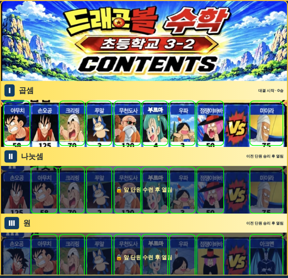

# 원기랜드 58차

## ⬇️ 다운로드

### **[👉 wonkiland_v58_새그림만.zip 받기 (HTML + 새 그림 104개, 약 11MB)](https://github.com/changdkand3-pixel/-/raw/claude/adoring-darwin-mewhr1/wonkiland-v58/wonkiland_v58_새그림만.zip)**

57차까지 그림을 올리셨다면 이 zip만 받으면 됩니다. 압축을 풀고 **안의 파일을 모두 선택해서** Neocities의 원기랜드 폴더(`작업장` 등)에 올리세요.

- HTML만 따로: [wonkiland_v58.html](https://github.com/changdkand3-pixel/-/raw/claude/adoring-darwin-mewhr1/wonkiland-v58/wonkiland_v58.html) (약 12MB)
- 처음부터 전부 올릴 때: [wonkiland_v58_neocities.zip](https://github.com/changdkand3-pixel/-/raw/claude/adoring-darwin-mewhr1/wonkiland-v58/wonkiland_v58_neocities.zip) (HTML + 그림 416개)

## 바뀐 점 (57차 → 58차)

1. **지난 업데이트 보기**: 업데이트 안내 카드(그리고 지도 도구의 "📢 58차 업데이트 안내")에서 **◀ 이전 차수 · 📜 전체 목록 · 다음 차수 ▶** 버튼으로 1차부터 58차까지 고를 수 있습니다. 48~57차는 내용이 나오고, **1~47차는 예전 기록이 파일에 남아 있지 않아 회색으로 "기록 없음"**이 나옵니다. 내용을 알려 주시면 채워 넣겠습니다.
2. **수학 초3-2**: 구글 드라이브 `문제파일/초3-2.pdf`의 원본 문제와 빠른 정답을 넣었습니다. Ⅰ 곱셈 22 · Ⅱ 나눗셈 22 · Ⅲ 원 10 · Ⅳ 분수 12 · Ⅴ 들이와 무게 20 · Ⅵ 자료의 정리 5문항 = **91문항**. 학습지의 92~100번 9문제는 초3이 아니라 고등학교 미적분(정적분·입체도형의 부피) 문제가 잘못 섞여 있어서 뺐습니다. 72번은 답이 여러 개라 띄어쓰기나 쉼표로 여러 개를 입력합니다.
3. **영어 초3-2**: 같은 목차 그림으로 대결합니다 (핵심 어휘 = Ⅰ·Ⅱ, 문법·표현 = Ⅲ·Ⅳ, 독해·문맥 = Ⅴ·Ⅵ 줄 캐릭터). 영어 문제는 그대로입니다.
4. **드라이브 `3-2` 폴더 그림 적용**: `초3-2.jpg` 목차와 캐릭터 그림으로 22명(손오공 125·140, 야무치 58·85, 크리링, 푸알, 무천도사, 부르마, 우파, 점쟁이 바바, 미이라, 아크맨, 손오반 할아버지 123·137, 피라후, 슈, 마이, 피라후·슈·마이 로봇, 보라, 신룡 150)을 만들었습니다.

## 이번에 새로 생긴 그림 (104개)

초3-2 문제 그림·목차·캐릭터 그림입니다. `wonkiland_v58_새그림만.zip`에 모두 들어 있습니다.

파일 이름 보기

- 02ded79ce752e5.webp
- 05038112dddac7.webp
- 09086cec552ada.webp
- 09f9139bea15f1.webp
- 0b2f320db7a826.webp
- 0cceb284563634.webp
- 0d43ca1ee93114.webp
- 1518a317d451c3.webp
- 17eefe6dbf017e.webp
- 18a66c3c930c2d.webp
- 1c4e7adeffa0f1.webp
- 1f40c7f3113780.webp
- 216defdd75031f.webp
- 218dd82af4b10f.webp
- 220072dc01daa7.webp
- 249717b3ff8d22.webp
- 24b888f8c788f0.webp
- 2815e8a9288771.webp
- 2c9ae107e8a45e.webp
- 2d7fddb5ea178c.webp
- 2f4242b10fca40.webp
- 31e7c7ef1abd66.webp
- 36a8d19449fff3.webp
- 3d904b0787ce6c.webp
- 3e9dc386ff711e.webp
- 46740dcf10b02b.webp
- 4962abbabd3b31.webp
- 4a119c5c958299.webp
- 4a9dc82f966b28.webp
- 4ac2cf1b41bedc.webp
- 4bdd8d53aba95e.webp
- 521498e5aea0a3.webp
- 52c96cf01c1092.webp
- 566d44bc99a275.webp
- 587b7738df85cb.webp
- 5ce9357e4e0e45.webp
- 5db7c1e8cf7d21.webp
- 633b23f72601f2.webp
- 638e68c685bdf5.webp
- 6505681973fa61.webp
- 655993f8842ecb.webp
- 693b3f99391ead.webp
- 69e6d0e4789b8a.webp
- 7069228cf4eca0.webp
- 7221d07ad1de0e.webp
- 72da8c9a7a89bb.webp
- 739c6ce9e7a13b.webp
- 78a4a2a3f005f9.webp
- 7e20ea082a9e23.webp
- 82d23a1c376ea2.webp
- 848df53ebd67a1.webp
- 8495b6b641e62e.webp
- 896939a7088968.webp
- 8b9f92b0df8c18.webp
- 8e6c5f908d9d09.webp
- 8ef99e72c8a951.webp
- 8f78291acb0a2f.webp
- 968257b732b93e.webp
- 97c028f889ac84.webp
- 9933ece7c23194.webp
- 9ac6a9592609e0.webp
- 9aefa6b4d187e2.webp
- 9d19c684a77811.webp
- 9dfe0f5e92da23.webp
- a36d014228a9f6.webp
- a711ca34c817d4.webp
- a88ff5adc78e09.webp
- a9d40789fc3ab5.webp
- aaa6b2413255b0.webp
- aafdd5c0f26cce.webp
- acb9ace5f65227.webp
- afa40adca0da93.webp
- afd1364425ab90.webp
- b0a9fc854ee76e.webp
- b2b6e0b332af3c.webp
- b4edc88279ba72.webp
- b4fe168a28d750.webp
- b714d70b7e12bb.webp
- b7e6e2fb858d0a.webp
- b90a06282941ae.webp
- bca9ecec549564.webp
- bdb5f69ce96bb2.webp
- bf7dda18f14f21.webp
- cbb7fa541688d1.webp
- cda39b13617aef.webp
- d20d7ccd80c1e6.webp
- dc67892b5ff542.webp
- ddd3f0121086e3.webp
- de171ab1cf0172.webp
- e045010fdab2b5.webp
- e25fcc04a02520.webp
- e26fe1dedb69f4.webp
- e4ec5d67d8e599.webp
- e62cf3a5b6f7de.webp
- eb9bd12cee4439.webp
- eba536e8e63a1f.webp
- eca6287e4c54d0.webp
- ef9f22ad6ec45b.webp
- f05adb511643ee.webp
- f2fd184ead96f8.webp
- f50a4df4328ab9.webp
- f75d66b20da8a4.webp
- fa4c15e6750634.webp
- ff16ccf2b7de08.webp

## 확인한 것

Chromium에서 확인했습니다: 그림 깨짐·못 불러온 파일 0개, 수학 초3-2 목차·대결·정답 처리, 영어 초3-2 대결·저장, 수학 초3-1 기존 대결, 건물 ✕ 동작, 업데이트 기록(1차 회색·50차 내용·최신으로 돌아가기·다시 보기), 스크립트 64개 구문 오류 없음.

