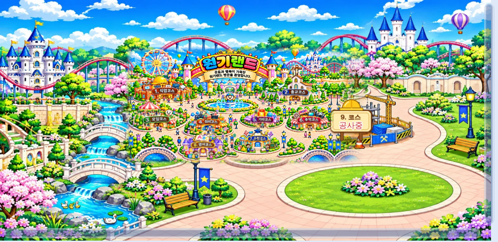

# 원기랜드 61차

## ⬇️ 다운로드

### **[👉 웰컴투 원기랜드.html 바로 받기 (약 12MB)](https://github.com/changdkand3-pixel/-/raw/claude/adoring-darwin-mewhr1/wonkiland-v61/%EC%9B%B0%EC%BB%B4%ED%88%AC%20%EC%9B%90%EA%B8%B0%EB%9E%9C%EB%93%9C.html)**

**이번에 새로 생긴 그림: 없음.** 그림은 이미 `작업장` 폴더에 있는 것을 그대로 씁니다.

## 올리는 곳

- 이 파일은 **`드래곤볼 수학게임` 폴더**에 올리세요. 파일 이름은 이미 `웰컴투 원기랜드.html`이라 바꿀 필요가 없습니다. 원기랜드의 공유 버튼 주소가 `드래곤볼 수학게임/웰컴투 원기랜드`입니다.
- 사이트 맨 위(루트)에 올렸던 `웰컴투 원기랜드` 파일은 지우셔도 됩니다. (그대로 두어도 이제는 그림이 나옵니다.)
- **그림 파일은 `작업장` 폴더에 그대로 두세요.** 61차부터 HTML을 어느 폴더에 두어도 그림은 항상 `작업장` 폴더에서 불러옵니다. 그림을 지우거나 옮기면 안 됩니다.

## 바뀐 점 (60차 → 61차)

- 그림 주소를 `작업장` 폴더 기준으로 바꿨습니다. 전에는 HTML과 **같은 폴더**의 그림만 찾아서, 다른 폴더(루트)에 올린 HTML은 그림이 안 나왔습니다.
- 61차 업데이트 안내 카드 (지난 업데이트 목록에 60차 추가).

## 확인한 것

이 HTML을 `드래곤볼 수학게임/웰컴투 원기랜드`와 루트 `웰컴투 원기랜드` 주소에서 연 것처럼 시험했고, 그림은 실제 Neocities `작업장` 폴더에서 모두 불러왔습니다(못 불러온 그림 0개). 스크립트 64개 구문 오류 없음.

