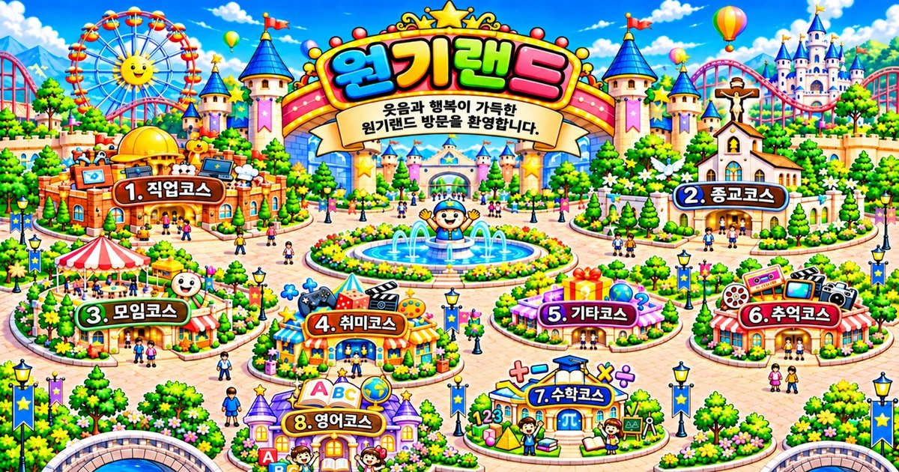

# 원기랜드 62차

## ⬇️ 다운로드 (2개)

1. **[👉 웰컴투 원기랜드.html](https://github.com/changdkand3-pixel/-/raw/claude/adoring-darwin-mewhr1/wonkiland-v62/%EC%9B%B0%EC%BB%B4%ED%88%AC%20%EC%9B%90%EA%B8%B0%EB%9E%9C%EB%93%9C.html)** (약 12MB) → **`드래곤볼 수학게임` 폴더**에 올리기
2. **[👉 wonkiland-share.jpg](https://github.com/changdkand3-pixel/-/raw/claude/adoring-darwin-mewhr1/wonkiland-v62/wonkiland-share.jpg)** (링크 미리보기 대표 그림, 0.4MB) → **`작업장` 폴더**에 올리기

이번에 새로 생긴 그림은 `wonkiland-share.jpg` 1개뿐입니다.

## 바뀐 점 (61차 → 62차)

- **링크 미리보기**: 페이스북·카카오톡·인스타그램 등에 원기랜드 주소를 공유하면 **"웰컴투 원기랜드 🎡" 제목, 설명, 원기랜드 지도 그림**이 카드로 보입니다.
- 브라우저 탭 제목을 예전 문구("원기랜드 50차 · 연결지도 적용 | … 수정 38") 대신 **"웰컴투 원기랜드"**로 바꿨습니다.
- 62차 업데이트 안내 카드 (지난 업데이트 목록에 61차 추가).

## 올린 뒤 미리보기가 예전 것으로 나오면

카카오톡과 페이스북은 미리보기를 한동안 저장해 둡니다.
- 페이스북: [공유 디버거](https://developers.facebook.com/tools/debug/)에 주소를 넣고 **"다시 스크랩"**을 누르세요.
- 카카오톡: [카카오 개발자 공유 디버거](https://developers.kakao.com/tool/debugger/sharing)에서 주소를 넣고 **캐시 초기화**를 누르세요. (카카오 로그인 필요)

