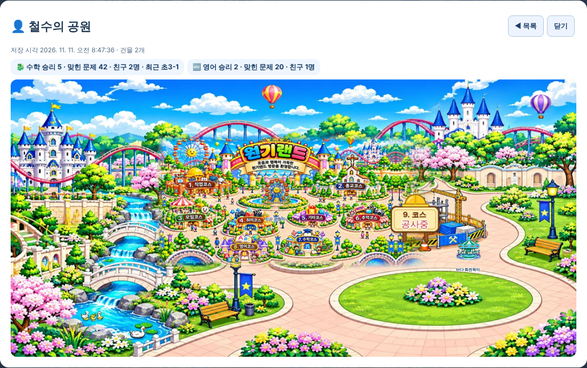

# 원기랜드 64차 — 공원 자랑하기 · 회원 공원 구경하기 · 빠른 동기화

## 해야 할 일 2가지

### 1. 서버 코드 바꾸기 (63차를 아직 안 하셨어도 이것 하나로 됩니다)

1. 받기: **[Code.gs(서버에 붙여넣기).txt](https://github.com/changdkand3-pixel/-/raw/claude/adoring-darwin-mewhr1/wonkiland-v64/Code.gs(%EC%84%9C%EB%B2%84%EC%97%90%20%EB%B6%99%EC%97%AC%EB%84%A3%EA%B8%B0).txt)**
2. [script.google.com](https://script.google.com)에서 **"제목 없는 프로젝트"**(10월 30일, `Code.gs`·`CloudSync.gs`가 있는 것)를 엽니다.
3. **`Code.gs`** 내용을 모두 지우고 받은 파일 내용을 붙여넣은 뒤 저장합니다.
4. **배포 → 배포 관리 → 연필(수정) → 버전 "새 버전" → 배포**. ("새 배포"는 주소가 바뀌니 누르지 마세요.)

63차 기능(일반회원 기록 저장)에 이번 기능 2개(공원 자랑 받기, 관리자 구경하기 목록)가 더해진 코드입니다. 기존 기능은 그대로입니다. 새 시트 **"공원자랑"**이 처음 받을 때 자동으로 생깁니다.

### 2. HTML 올리기

**[웰컴투 원기랜드.html](https://github.com/changdkand3-pixel/-/raw/claude/adoring-darwin-mewhr1/wonkiland-v64/%EC%9B%B0%EC%BB%B4%ED%88%AC%20%EC%9B%90%EA%B8%B0%EB%9E%9C%EB%93%9C.html)** → **`드래곤볼 수학게임` 폴더**. 새 그림은 없습니다.

## 바뀐 점 (63차 → 64차)

1. **🏆 내 공원 자랑하기** (지도 도구 줄): 방문자·회원 누구나, **원할 때만** 이름(별명)과 한마디를 적어 자기 공원을 관리자에게 보냅니다. 같은 사람은 1분에 한 번만 보낼 수 있습니다.
2. **🔒 회원 공원 구경하기** (지도 도구 줄, 관리자 Google 계정 전용): 일반회원 목록(건물 수, 수학·영어 승리·맞힌 문제·친구 수)과 받은 공원 자랑 목록이 나오고, 누르면 **그 사람이 지은 건물이 원기랜드 지도 위에** 보입니다.
3. **휴대폰 전체 동기화 빠르게**
   - 매번 최대 15초 기다리던 "서버 연결 확인"을 뺐습니다.
   - 관리자 Google 로그인을 **1시간 동안 기억**해서, 그동안은 로그인 창 없이 바로 동기화합니다.
   - 상상코칭 회원과 일반회원 자료를 **동시에** 읽습니다.
   - 바뀐 것이 없으면 일반회원·방명록 **저장을 건너뜁니다**.
   - 가짜 서버(요청마다 1.5초)로 시험: 바뀐 것이 없을 때 전체 동기화 **약 2초**.
4. 64차 업데이트 안내 카드.

