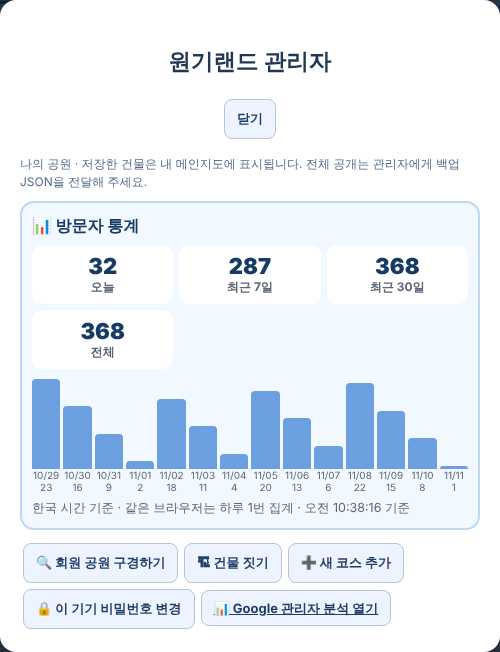

# 원기랜드 65차 — 구경하기는 관리자만 · 관리자 메뉴 방문자 통계 · 내 공원 공개하기

## 해야 할 일 2가지

### 1. HTML 올리기 (새 그림 없음 → HTML 하나만 올리면 됨)

**[웰컴투 원기랜드.html](https://github.com/changdkand3-pixel/-/raw/claude/adoring-darwin-mewhr1/wonkiland-v65/%EC%9B%B0%EC%BB%B4%ED%88%AC%20%EC%9B%90%EA%B8%B0%EB%9E%9C%EB%93%9C.html)** (약 12MB) → **`드래곤볼 수학게임` 폴더**에 덮어 올립니다.

그림까지 한 번에 받기: [wonkiland_v65_neocities.zip](https://github.com/changdkand3-pixel/-/raw/claude/adoring-darwin-mewhr1/wonkiland-v65/wonkiland_v65_neocities.zip). 그림 파일은 64차와 같아서 **`작업장` 폴더에 다시 올릴 필요가 없습니다.**

**이번에 새로 생긴 그림 파일:** 없음

### 2. 서버 코드 바꾸기 (7일·30일·날짜별 통계용, 안 해도 오늘·전체 숫자는 보임)

1. 받기: **[Code.gs(서버에 붙여넣기).txt](https://github.com/changdkand3-pixel/-/raw/claude/adoring-darwin-mewhr1/wonkiland-v65/Code.gs(%EC%84%9C%EB%B2%84%EC%97%90%20%EB%B6%99%EC%97%AC%EB%84%A3%EA%B8%B0).txt)**
2. [script.google.com](https://script.google.com)에서 **"제목 없는 프로젝트"**(`Code.gs`·`CloudSync.gs`가 있는 것)를 엽니다.
3. **`Code.gs`** 내용을 모두 지우고 받은 내용을 붙여넣은 뒤 저장합니다.
4. **배포 → 배포 관리 → 연필(수정) → 버전 "새 버전" → 배포**. ("새 배포"는 주소가 바뀌니 누르지 마세요.)

64차 코드에 `admin_visitor_stats`(관리자 전용) 하나만 더한 것입니다. 64차를 아직 안 붙여넣으셨어도 이것 하나로 63·64·65차 기능이 모두 됩니다.

## 바뀐 점 (64차 → 65차)

1. **🔍 회원 공원 구경하기 버튼은 관리자 기기에서만 보입니다.**
   - 처음에는 아무에게도 안 보입니다.
   - **🔒 관리자 분석**(또는 지도 도구의 🔒 관리자) → 비밀번호 → 관리자 메뉴에 **🔍 회원 공원 구경하기**가 있습니다.
   - 관리자 메뉴를 한 번 연 기기에서는 그다음부터 지도 도구 줄에도 버튼이 보입니다.
   - 목록 자체는 예전처럼 관리자 Google 계정만 서버에서 받을 수 있습니다.
2. **관리자 메뉴에 📊 방문자 통계가 바로 보입니다.**
   - 원인: 🔒 관리자 분석을 누르면 비밀번호 뒤에 건물 메뉴만 나오고 통계가 없었습니다. 구글 시트 "원기랜드 분석" 탭의 숫자(오늘 32명·전체 368명)는 정상이었습니다.
   - 이제 메뉴 위쪽에 **오늘 · 전체**가 바로 보입니다.
   - **📈 7일·30일·날짜별 통계 보기**를 누르면(관리자 Google 로그인) 최근 7일·30일과 **최근 14일 날짜별 막대**가 나옵니다. 1시간 안에 다시 열면 로그인 없이 바로 나옵니다.
3. **🏆 내 공원 자랑하기 → 📣 내 공원 공개하기**로 이름을 바꿨습니다. 구경하기 화면의 탭도 "📣 공개한 공원"입니다.
4. 65차 업데이트 안내 카드.

