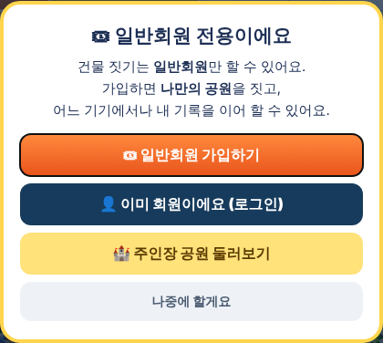
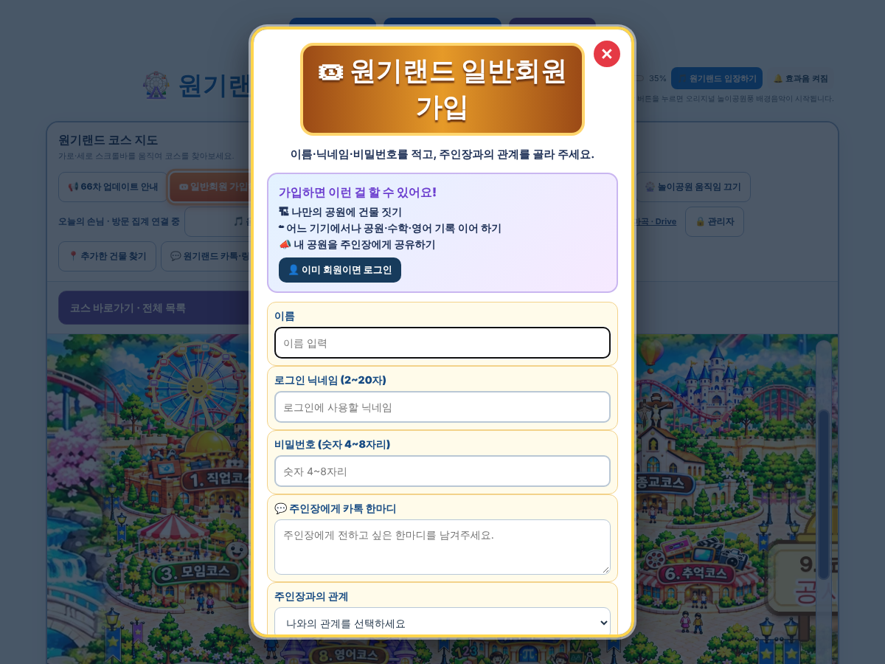
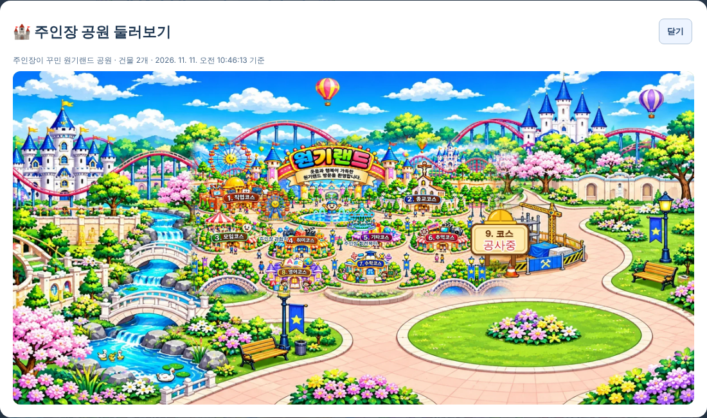

# 원기랜드 66차 — 방문자는 둘러보기 · 일반회원은 내 공원 짓기 · 주인장 공원 둘러보기

## 해야 할 일 3가지

### 1. 서버 코드 바꾸기 (주인장 공원 올리기·둘러보기용)

1. 받기: **[Code.gs(서버에 붙여넣기).txt](https://github.com/changdkand3-pixel/-/raw/claude/adoring-darwin-mewhr1/wonkiland-v66/Code.gs(%EC%84%9C%EB%B2%84%EC%97%90%20%EB%B6%99%EC%97%AC%EB%84%A3%EA%B8%B0).txt)**
2. [script.google.com](https://script.google.com)에서 **"제목 없는 프로젝트"**(`Code.gs`·`CloudSync.gs`가 있는 것)를 엽니다.
3. **`Code.gs`** 내용을 모두 지우고 받은 내용을 붙여넣은 뒤 저장합니다.
4. **배포 → 배포 관리 → 연필(수정) → 버전 "새 버전" → 배포**. ("새 배포"는 주소가 바뀌니 누르지 마세요.)

63~65차 기능이 모두 들어 있어서 이것 하나만 붙여넣으면 됩니다. 새 시트 **"주인장공원"**이 처음 올릴 때 자동으로 생깁니다.

### 2. HTML 올리기 (새 그림 없음 → HTML 하나만 올리면 됨)

**[웰컴투 원기랜드.html](https://github.com/changdkand3-pixel/-/raw/claude/adoring-darwin-mewhr1/wonkiland-v66/%EC%9B%B0%EC%BB%B4%ED%88%AC%20%EC%9B%90%EA%B8%B0%EB%9E%9C%EB%93%9C.html)** (약 12MB) → **`드래곤볼 수학게임` 폴더**에 덮어 올립니다.

그림까지 한 번에 받기: [wonkiland_v66_neocities.zip](https://github.com/changdkand3-pixel/-/raw/claude/adoring-darwin-mewhr1/wonkiland-v66/wonkiland_v66_neocities.zip). 그림은 65차와 같아서 `작업장` 폴더에 다시 올릴 필요가 없습니다.

**이번에 새로 생긴 그림 파일:** 없음

### 3. 주인장 공원 올리기 (주인장 기기에서 한 번)

1. 주인장이 쓰는 기기에서 **일반회원 로그인 없이** 원기랜드를 엽니다.
2. **🔒 관리자** → 비밀번호 → **🏗 건물 짓기**로 주인장 공원을 꾸밉니다. (예전에 이 기기에서 지은 건물이 그대로 주인장 공원입니다.)
3. 관리자 메뉴의 **🏰 주인장 공원 올리기** (또는 지도 도구 줄의 **📤 주인장 공원 올리기**)를 누르고 Google 관리자 로그인을 합니다.
4. 건물을 바꿀 때마다 다시 올리면 됩니다.

## 바뀐 점 (65차 → 66차)

| 누구 | 메인 지도에 보이는 건물 | 할 수 있는 것 |
|---|---|---|
| **방문자** (로그인 안 함) | 주인장 공원 | 둘러보기만. 건물을 눌러도 고쳐지지 않고, 🏗 건물 짓기·➕ 새 코스·📣 공유하기 버튼이 없습니다. |
| **일반회원** (로그인) | **내 공원만** (주인장 것과 섞이지 않음) | 🏗 건물 짓기, ➕ 새 코스, 📣 내 공원 공유하기, 🏰 주인장 공원 둘러보기 |
| **주인장 기기** | 주인장 공원 | 건물 짓기, 📤 주인장 공원 올리기, 회원 공원 구경하기, 방문자 통계 |

1. **🏰 주인장 공원 둘러보기** 버튼: 누구나 누르면 주인장 공원이 지도 그림으로 크게 보입니다.
2. **📣 내 공원 공유하기**: 이름을 "공개하기"에서 바꿨고, 일반회원만 쓸 수 있습니다. 공유한 공원은 주인장이 🔍 회원 공원 구경하기에서 봅니다.
3. 방문자가 건물 짓기를 누르면 **"일반회원 전용이에요"** 안내가 뜨고, 가입·로그인·주인장 공원 둘러보기로 바로 갈 수 있습니다.
4. **일반회원 가입을 눈에 띄게**
   - 지도 도구 줄 맨 앞에 주황색 **🎟 일반회원 가입하고 내 공원 짓기** 버튼이 생겼습니다(방문자에게만 보임).
   - 방문자 수 옆 "＋ 신규회원"은 **🎟 일반회원 가입**으로 이름을 바꾸고 주황색으로 눈에 띄게 했습니다(로그인하면 숨김).
   - 가입 화면은 배경이 비쳐 글씨가 잘 안 보였는데, 이제 **하얀 카드**로 또렷하고 "가입하면 할 수 있는 것" 안내와 로그인 버튼이 있습니다.
   - 이 기기에서 등록한 회원 명단은 주인장 기기에서만 보입니다.
5. 66차 업데이트 안내 카드.

방문자가 예전에 이 기기에서 지어 둔 건물은 지워지지 않고 이 기기에 보관만 됩니다(지도에는 안 보임).

