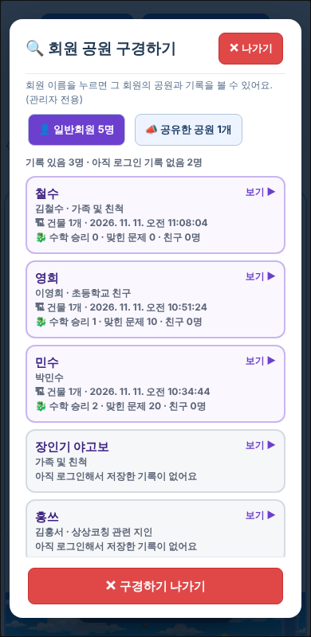

# 원기랜드 67차 — 회원 공원 구경하기: 회원 눌러 보기 · 나가기 칸

## 올리는 방법 (HTML 하나만 올리면 됨)

**[웰컴투 원기랜드.html](https://github.com/changdkand3-pixel/-/raw/claude/adoring-darwin-mewhr1/wonkiland-v67/%EC%9B%B0%EC%BB%B4%ED%88%AC%20%EC%9B%90%EA%B8%B0%EB%9E%9C%EB%93%9C.html)** (약 12MB) → **`드래곤볼 수학게임` 폴더**에 덮어 올립니다. 미리 보려면 `작업장` 폴더에 먼저 올려서 열어 봐도 됩니다.

그림까지 한 번에 받기: [wonkiland_v67_neocities.zip](https://github.com/changdkand3-pixel/-/raw/claude/adoring-darwin-mewhr1/wonkiland-v67/wonkiland_v67_neocities.zip). 그림은 66차와 같습니다.

**이번에 새로 생긴 그림 파일:** 없음

**서버 코드:** 이번에는 바꿀 것이 없습니다. (66차 Code_66을 아직 안 붙여넣으셨다면 [66차 안내](../wonkiland-v66/README.md)대로 해 주세요.)

## 바뀐 점 (66차 → 67차)

1. **가입한 일반회원이 모두 목록에 나옵니다.**
   - 예전에는 63차 이후 로그인해서 기록이 저장된 회원만 보였습니다.
   - 이제 가입한 회원 전원이 나오고, 기록이 있는 회원이 위에 옵니다(최근 저장 순). 아직 기록이 없는 회원은 회색 칸입니다.
   - 각 칸에 닉네임, 이름·관계, 건물 수, 수학·영어 기록과 **보기 ▶** 표시가 있습니다.
2. **회원을 누르면** 그 회원의 공원(지도 위 건물)과 기록이 나옵니다. 기록이 없는 회원은 "아직 로그인해서 저장한 기록이 없어요"라고 나옵니다.
3. **빠져나오는 칸**
   - 위쪽에 **✕ 나가기**(빨간색)와 **◀ 목록**이 있고, 스크롤해도 늘 보입니다.
   - 아래쪽에도 큰 **◀ 회원 목록으로** · **✕ 구경하기 나가기** 칸이 고정되어 있습니다.
   - 키보드 **Esc**, 바깥(어두운 곳) 누르기, **휴대폰 뒤로 가기**로도 나갑니다(회원 공원에서는 먼저 목록으로 돌아감).
4. 67차 업데이트 안내 카드.

