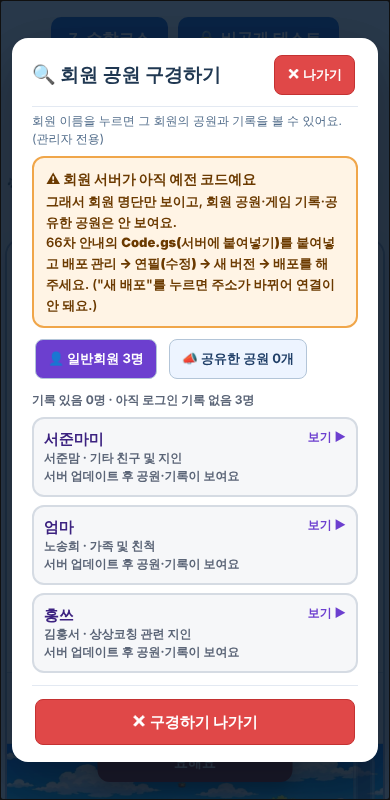
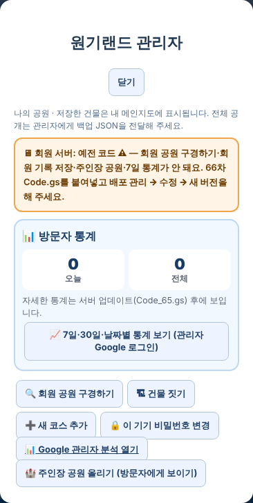

# 원기랜드 69차 — 회원 공원 구경하기 목록이 안 보이던 문제

## 원인

실제 회원 서버를 확인해 보니 **아직 예전(62차) 코드**입니다. 63~66차에 만든 서버 기능이 하나도 없어서, 구경하기를 눌러도 서버가 "지원하지 않는 요청"이라고 답했고 목록이 열리지 않았습니다.

서버가 예전 코드라서 지금 안 되는 것:
- 🔍 회원 공원 구경하기 (회원 공원·기록, 공유한 공원)
- ☁ 일반회원 기록(공원·수학·영어) 클라우드 저장
- 📣 내 공원 공유하기
- 🏰 주인장 공원 올리기 → 방문자 지도에 주인장 공원이 안 보임
- 📈 7일·30일 방문 통계

## 해야 할 일 2가지

### 1. 서버 코드 바꾸기 (가장 중요)

1. 받기: **[Code.gs(서버에 붙여넣기).txt](https://github.com/changdkand3-pixel/-/raw/claude/adoring-darwin-mewhr1/wonkiland-v69/Code.gs(%EC%84%9C%EB%B2%84%EC%97%90%20%EB%B6%99%EC%97%AC%EB%84%A3%EA%B8%B0).txt)** (66차와 같은 파일)
2. [script.google.com](https://script.google.com)에서 **"제목 없는 프로젝트"**(`Code.gs`·`CloudSync.gs`가 있는 것)를 엽니다.
3. 왼쪽에서 **`Code.gs`** 를 누르고, 내용을 **모두 지운 뒤** 받은 파일 내용을 붙여넣고 **저장(💾)** 합니다.
4. 오른쪽 위 **배포 → 배포 관리** → 기존 배포 옆 **연필(수정)** → 버전에서 **"새 버전"** 을 고르고 → **배포**.
   - **"새 배포"는 누르지 마세요.** 주소가 바뀌어 원기랜드와 연결이 끊깁니다.
5. 다 했으면 원기랜드 **🔒 관리자** 메뉴 맨 위에 **"🖥 회원 서버: 최신 코드 ✅"** 가 나오는지 확인합니다.

### 2. HTML 올리기 (새 그림 없음 → HTML 하나만 올리면 됨)

**[웰컴투 원기랜드.html](https://github.com/changdkand3-pixel/-/raw/claude/adoring-darwin-mewhr1/wonkiland-v69/%EC%9B%B0%EC%BB%B4%ED%88%AC%20%EC%9B%90%EA%B8%B0%EB%9E%9C%EB%93%9C.html)** → `작업장`에서 먼저 시험한 뒤 **`드래곤볼 수학게임` 폴더**에 덮어 올립니다.

그림까지 한 번에 받기: [wonkiland_v69_neocities.zip](https://github.com/changdkand3-pixel/-/raw/claude/adoring-darwin-mewhr1/wonkiland-v69/wonkiland_v69_neocities.zip).

**이번에 새로 생긴 그림 파일:** 없음

## 바뀐 점 (68차 → 69차)

1. 서버가 예전 코드여도 **가입한 회원 명단은 바로 보입니다**(예전부터 있던 회원 명단 기능을 사용). 대신 맨 위에 주황색으로 **"회원 서버가 아직 예전 코드예요"** 안내와 고치는 방법이 나옵니다.
2. 회원을 누르면, 서버가 예전 코드일 때는 "서버 업데이트 후 보여요"라고 알려 줍니다.
3. **🔒 관리자 메뉴 맨 위에 회원 서버 상태**가 나옵니다: ✅ 최신 코드 / ⚠ 예전 코드.
4. 오류가 나면 아래 작은 알림만 뜨던 것을, 구경하기 화면 안에 보여 줍니다.
5. 69차 업데이트 안내 카드.

