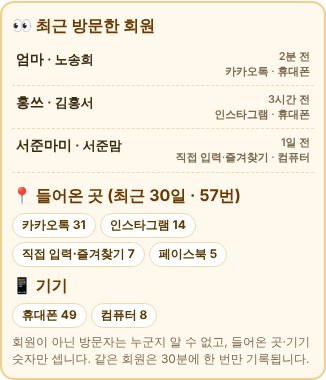

# 원기랜드 70차 — 누가 다녀갔는지 보기 (회원 방문 기록 · 들어온 곳 통계)

## 해야 할 일 2가지

### 1. 서버 코드 바꾸기

1. 받기: **[Code.gs(서버에 붙여넣기).txt](https://github.com/changdkand3-pixel/-/raw/claude/adoring-darwin-mewhr1/wonkiland-v70/Code.gs(%EC%84%9C%EB%B2%84%EC%97%90%20%EB%B6%99%EC%97%AC%EB%84%A3%EA%B8%B0).txt)**
2. **[10월 30일에 만든 "제목 없는 프로젝트"](https://script.google.com/d/1PQaf8fdRq8G838KeiqII1kHgTSn6NDYEbTqu-12xqnNfLAEneH2GAFUF/edit)** 를 엽니다. (11월 6일에 만든 같은 이름 프로젝트가 아닙니다.)
3. **`Code.gs`** 내용을 모두 지우고 받은 내용을 붙여넣은 뒤 저장합니다. `CloudSync.gs`는 그대로 둡니다.
4. **배포 → 배포 관리 → 연필(수정) → 버전 "새 버전" → 배포**. ("새 배포"는 누르지 마세요.)

66차 코드에 방문 기록 두 가지(`visit_log`, `admin_visit_log`)만 더한 것입니다. 새 시트 **"방문기록"**이 처음 기록할 때 자동으로 생깁니다.

### 2. HTML 올리기 (새 그림 없음 → HTML 하나만 올리면 됨)

**[웰컴투 원기랜드.html](https://github.com/changdkand3-pixel/-/raw/claude/adoring-darwin-mewhr1/wonkiland-v70/%EC%9B%B0%EC%BB%B4%ED%88%AC%20%EC%9B%90%EA%B8%B0%EB%9E%9C%EB%93%9C.html)** → `작업장`에서 먼저 시험한 뒤 **`드래곤볼 수학게임` 폴더**에 `웰컴투 원기랜드.html` 이름 그대로 덮어 올립니다.

그림까지 한 번에 받기: [wonkiland_v70_neocities.zip](https://github.com/changdkand3-pixel/-/raw/claude/adoring-darwin-mewhr1/wonkiland-v70/wonkiland_v70_neocities.zip).

**이번에 새로 생긴 그림 파일:** 없음

## 바뀐 점 (69차 → 70차)

**🔒 관리자 메뉴 → 👀 최근 방문한 회원** (관리자 Google 로그인 필요, 1시간 기억)

1. **최근 방문한 회원:** 로그인한 일반회원의 **닉네임·이름·방문 시각**("2분 전", "3시간 전"…)과 들어온 곳·기기. 최근 50명까지 보입니다. 같은 회원은 30분에 한 번만 기록합니다.
2. **📍 들어온 곳 (최근 30일):** 카카오톡 · 인스타그램 · 페이스북 · 네이버 · 밴드 · 구글 · 다음 · 기타 링크 · 직접 입력·즐겨찾기
3. **📱 기기:** 휴대폰 · 태블릿 · 컴퓨터
4. 회원이 알 수 있게 **로그인 창과 가입 화면에** "🔔 로그인하면 주인장에게 방문 기록(닉네임·방문 시각)이 보여요." 안내를 넣었습니다.
5. 70차 업데이트 안내 카드.

**알 수 없는 것:** 로그인하지 않은 방문자가 누구인지는 알 수 없습니다. 들어온 곳·기기 숫자만 셉니다(같은 브라우저는 6시간에 한 번). 주인장 기기의 방문은 세지 않습니다.

기록은 구글 시트 "원기랜드 클라우드 회원정보"의 **"방문기록"** 탭에도 쌓입니다.

