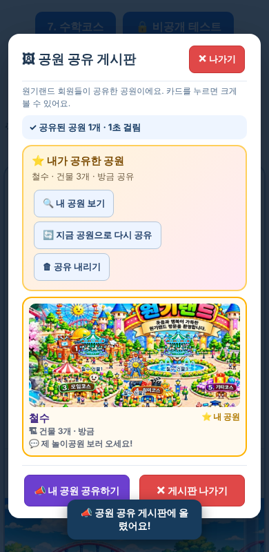

# 원기랜드 74차 — 🖼 공원 공유 게시판

## 해야 할 일 2가지

### 1. 서버 코드 바꾸기

1. 받기: **[Code.gs(서버에 붙여넣기).txt](https://github.com/changdkand3-pixel/-/raw/claude/adoring-darwin-mewhr1/wonkiland-v74/Code.gs(%EC%84%9C%EB%B2%84%EC%97%90%20%EB%B6%99%EC%97%AC%EB%84%A3%EA%B8%B0).txt)**
2. **[10월 30일에 만든 "제목 없는 프로젝트"](https://script.google.com/d/1PQaf8fdRq8G838KeiqII1kHgTSn6NDYEbTqu-12xqnNfLAEneH2GAFUF/edit)** 를 엽니다.
3. **`Code.gs`** 내용을 모두 지우고 받은 내용을 붙여넣은 뒤 저장합니다. `CloudSync.gs`는 그대로 둡니다.
4. **배포 → 배포 관리 → 연필(수정) → 버전 "새 버전" → 배포**. ("새 배포"는 누르지 마세요.)

70차 코드에 게시판 기능 4가지(`park_gallery_list` · `park_gallery_share` · `park_gallery_unshare` · `admin_gallery_hide`)만 더했습니다. 새 시트 **"공원공유게시판"**이 처음 공유할 때 자동으로 생깁니다.

### 2. HTML 올리기 (새 그림 없음 → HTML 하나만 올리면 됨)

**[웰컴투 원기랜드.html](https://github.com/changdkand3-pixel/-/raw/claude/adoring-darwin-mewhr1/wonkiland-v74/%EC%9B%B0%EC%BB%B4%ED%88%AC%20%EC%9B%90%EA%B8%B0%EB%9E%9C%EB%93%9C.html)** → `작업장`에서 먼저 시험한 뒤 **`드래곤볼 수학게임` 폴더**에 `웰컴투 원기랜드.html` 이름 그대로 덮어 올립니다.

그림까지 한 번에 받기: [wonkiland_v74_neocities.zip](https://github.com/changdkand3-pixel/-/raw/claude/adoring-darwin-mewhr1/wonkiland-v74/wonkiland_v74_neocities.zip).

**이번에 새로 생긴 그림 파일:** 없음

## 바뀐 점 (73차 → 74차)

1. **🖼 공원 공유 게시판** (지도 도구 줄, 누구나): 회원들이 공유한 공원이 지도 그림 카드로 보입니다. 카드를 누르면 건물이 있는 곳을 크게 보여 줍니다.
2. **📣 내 공원 공유하기** (일반회원): 예전에는 관리자에게만 보냈는데, 이제 **게시판에 올라가서 모두가 볼 수 있습니다**. 이름(별명)과 소개 한마디를 적습니다.
   - 한 사람당 하나만 올라가고, 다시 공유하면 지금 공원으로 바뀝니다.
3. **⭐ 내가 공유한 공원** (게시판 맨 위): 내 공원 보기 · 지금 공원으로 다시 공유 · 공유 내리기.
4. 방문자는 게시판을 볼 수만 있고, "일반회원으로 로그인하면 공유할 수 있어요" 안내가 나옵니다.
5. **주인장 기기**에서는 공원을 눌렀을 때 **🚫 게시판에서 내리기** 버튼이 있습니다(관리자 Google 로그인). 내려진 공원은 그 회원이 다시 올릴 수 없습니다.
6. 게시판 목록은 기기에 기억해 두었다가 다음에 열 때 먼저 보여 줍니다.
7. 74차 업데이트 안내 카드.

예전에 "관리자에게 보내기"로 받은 공원(시트 "공원자랑")은 그대로 관리자 구경하기의 "공유한 공원" 탭에만 보이고, 게시판에는 나오지 않습니다.

