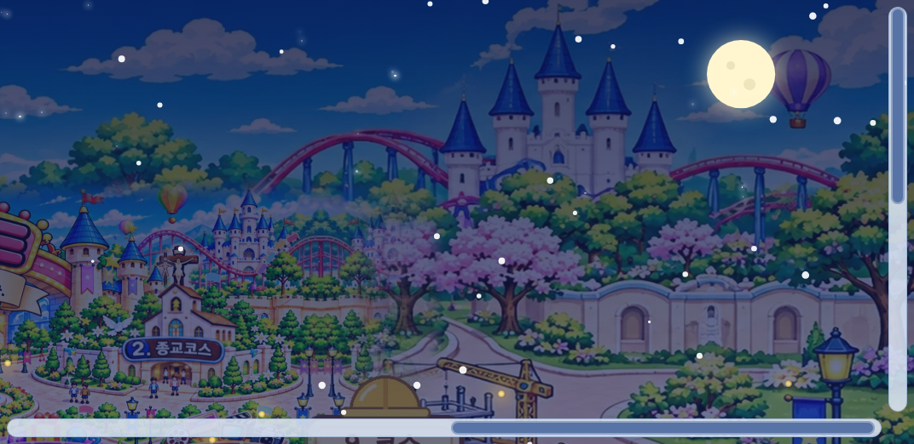
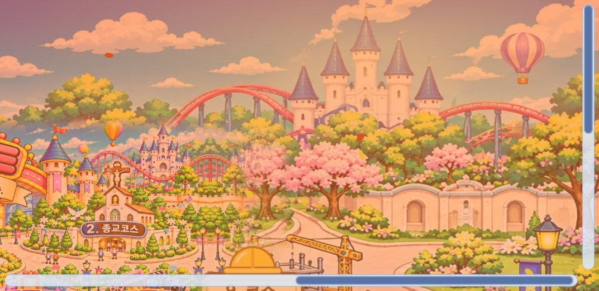

# 원기랜드 76차 — 시간·날씨·달 모양에 따라 바뀌는 메인 지도

## 올리는 방법 (HTML 하나만 올리면 됨)

**[웰컴투 원기랜드.html](https://github.com/changdkand3-pixel/-/raw/claude/adoring-darwin-mewhr1/wonkiland-v76/%EC%9B%B0%EC%BB%B4%ED%88%AC%20%EC%9B%90%EA%B8%B0%EB%9E%9C%EB%93%9C.html)** → `작업장`에서 먼저 시험한 뒤 **`드래곤볼 수학게임` 폴더**에 `웰컴투 원기랜드.html` 이름 그대로 덮어 올립니다.

그림까지 한 번에 받기: [wonkiland_v76_neocities.zip](https://github.com/changdkand3-pixel/-/raw/claude/adoring-darwin-mewhr1/wonkiland-v76/wonkiland_v76_neocities.zip).

**이번에 새로 생긴 그림 파일:** 없음 (풍경은 그림 파일 없이 화면 효과로 그립니다) · **서버 코드:** 바꿀 것 없음

## 바뀐 점 (75차 → 76차)

### 1. 시간대 풍경 (한국 시간, 자동)

| 시간 | 풍경 |
|---|---|
| ☀️ 오전 6~12시 | 맑은 아침 햇살 |
| 🌤 오후 12~17시 | 지금 지도 그대로 밝은 낮 |
| 🌇 저녁 17~20시 | 주황·분홍 노을빛 |
| 🌙 밤 20~6시 | 어두운 남색 하늘, 반짝이는 별, 달, 곳곳의 불빛, 건물에 따뜻한 불빛 |

### 2. 날씨 — 서울 실시간 (동물의 숲처럼)

- 방문한 사람의 브라우저가 무료 날씨 서비스(Open-Meteo)에서 **서울의 지금 날씨와 기온**을 받아 20분마다 반영합니다.
- 맑음 → 맑음 · 구름/안개 → ☁️ 흐림 · 비/소나기/뇌우 → 🌧 비 · 눈 → ❄️ 눈
- 날씨를 받지 못하면 **계절 무작위 날씨**로 보여 줍니다. 3시간마다 바뀌고 같은 시간엔 누구나 같은 날씨입니다.
  - 11월: 맑음·흐림·비·🍁낙엽·❄️눈
  - 12~2월: 눈이 자주 옴
  - 봄: 🌸꽃잎
- 지도 왼쪽 위에 지금 상태가 표시됩니다. 예: "🌙 밤 · 🌒 초승달 · ❄️ 눈 1°C (서울)"

### 3. 달 모양 — 실제 달을 따라 매일 바뀜

그믐·초승달 → 초승달 → 반달(상현달) → 차오르는 달 → 보름달 → 기우는 달 → 반달(하현달) → 그믐달 순서로, 한 달 동안 골고루 나옵니다. 달이 안 보이는 날(삭)에도 가는 달을 보여 줍니다.

### 4. 버튼 (지도 도구 줄)

- **🌗 풍경**: 자동 → 오전 → 오후 → 저녁 → 밤 → 끄기 (미리 보기용)
- **🌦 날씨**: 서울 실시간 → 계절 무작위 → 맑음 → 흐림 → 비 → 눈 → 낙엽 → 꽃잎 → 끄기
- 고른 것은 그 기기에만 기억됩니다. 지도 버튼(코스)은 그대로 누를 수 있습니다.
- 기기에서 "동작 줄이기"를 켠 사람에게는 눈·비가 움직이지 않습니다.
- 화면을 안 보고 있을 때는 멈춰서 휴대폰 배터리를 아낍니다.

### 5. 76차 업데이트 안내 카드

